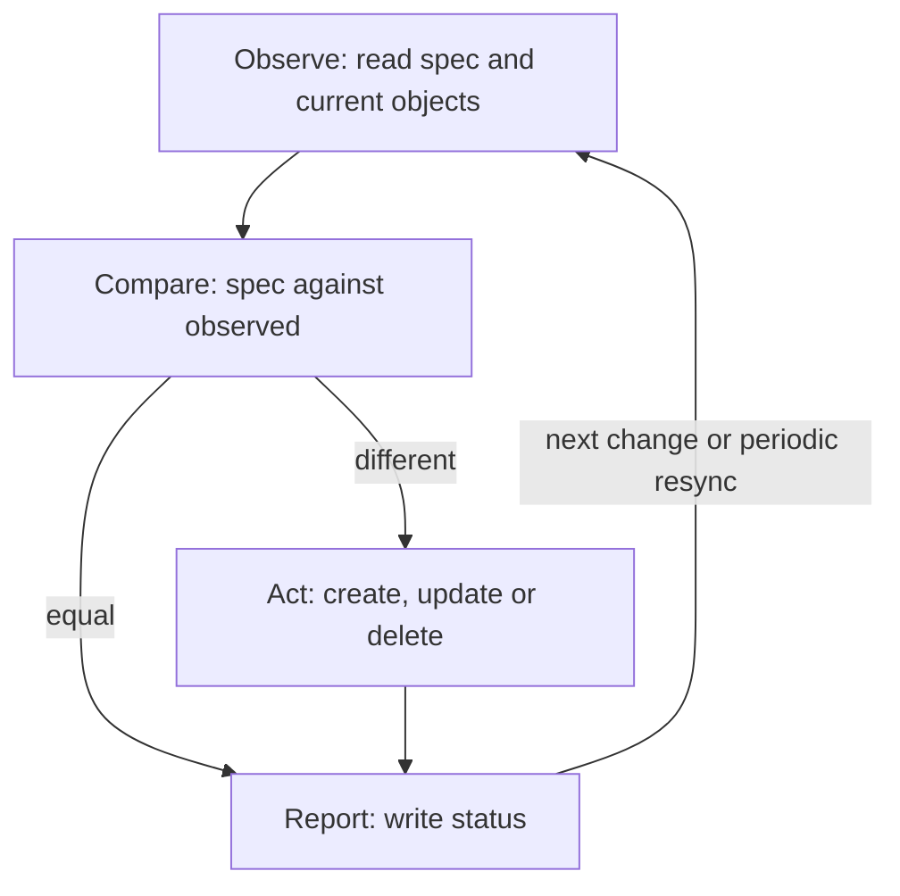

# Spec, Status And The Control Loop

A command such as "start two copies of this program" can only succeed or fail once. A cluster needs more than that. Nodes fail, pods are deleted, and people edit objects by hand. Kubernetes solves this by storing a description of what you want and running programs that keep working until the cluster matches the description. This part shows what that description is, where the observed facts are stored, and what one pass of the work looks like.

## Desired state and observed state

**Desired state** is what you declare: for example, "the `scout` Deployment has two replicas of this container image." **Observed state** is what the cluster really has at this moment: for example, "one `scout` pod is ready and one is starting." Kubernetes keeps both on the same object. The `spec` field holds the desired state. The `status` field holds the observed state.

The two fields have different writers. You, or a tool that acts for you, write `spec`. A **controller** writes `status`. A controller is a program that watches objects of one or more kinds and changes the cluster so that the observed state moves toward the desired state. The API server stores both fields in etcd, and it does not decide anything about them.

Look at a real object first. The playground runs the `scout` Deployment with two replicas. This command prints the desired number and the number that is ready:

<!-- astrona:playground:renew -->

```sh
kubectl -n starfleet get deployment scout -o jsonpath='{.spec.replicas}{" "}{.status.readyReplicas}{"\n"}'
```

It prints `2 2` when the Deployment has converged: the first number comes from `spec`, the second from `status`. Now print the whole `status` block to see what else the controller reports:

```sh
kubectl -n starfleet get deployment scout -o jsonpath='{.status}{"\n"}'
```

The result is a JSON object. It has the counters `replicas`, `updatedReplicas`, `readyReplicas` and `availableReplicas`. It has a list `conditions` with the entries `Available` and `Progressing`. It has `observedGeneration`, which later sections of this part explain. The exact content depends on the moment you run the command.

## The four steps of one reconciliation

Every controller runs the same loop, and the loop is called **reconciliation**. One pass has four steps.

1. **Observe.** Read the object that changed and the objects that belong to it. The Deployment controller reads the Deployment and the ReplicaSets that it owns.
2. **Compare.** Decide whether the observed state matches `spec`. For `scout` the question is whether the number of ready pods equals 2.
3. **Act.** Send requests to the API server that reduce the difference: create a ReplicaSet, change its replica count, or delete an object.
4. **Report.** Write the result into `status`, so that users and other controllers can read it.



The diagram shows that the loop never ends: after the report the controller waits for the next change and starts again. If the state already matches, the "act" step does nothing and the pass only updates `status`.

## Which component does the work

Several components touch a Deployment, and each has a narrow job. The **kube-apiserver** accepts requests, checks them and stores objects. The **Deployment controller** and the **ReplicaSet controller** both run inside one program, the **kube-controller-manager**. The **scheduler** picks a node for each new pod. The **kubelet** on the node starts the containers and reports the pod status.

In the playground the kube-controller-manager runs as a pod in the `kube-system` namespace. You can find it with its label:

```sh
kubectl -n kube-system get pods -l component=kube-controller-manager
```

The command prints one pod. This is the program that does the work of the next example. The Deployment controller does not start any container. It only creates and changes API objects, and other components react to those objects.

## One loop pass that you can watch

Change the desired state and read the observed state while the controller reacts. This command changes `spec.replicas` from 2 to 3:

```sh
kubectl -n starfleet scale deployment scout --replicas=3
```

The API server stores the new `spec`. The Deployment controller sees the change, compares 3 with the ReplicaSet size, and raises the ReplicaSet to 3. The ReplicaSet controller creates one pod, the scheduler places it, and the kubelet starts it. Read the two numbers again, quickly, and then again after a few seconds:

```sh
kubectl -n starfleet get deployment scout -o jsonpath='{.spec.replicas} {.status.replicas} {.status.readyReplicas}{"\n"}'
```

The first run can show `3 2 2` or `3 3 2`, because the new pod is not ready yet. A later run shows `3 3 3`. The gap between the first number and the others is the work that the controller has not finished. When all three numbers are equal, the cluster has converged.

## Generation and observedGeneration

A reader of `status` needs to know whether the controller has already seen the latest `spec`. Two numbers answer that. `metadata.generation` is a counter that the API server raises each time the `spec` changes. `status.observedGeneration` is the generation that the controller last processed.

```sh
kubectl -n starfleet get deployment scout -o jsonpath='{.metadata.generation} {.status.observedGeneration}{"\n"}'
```

When the two numbers are equal, the `status` describes the current `spec`. When `generation` is higher, the `status` is old: it was written for an earlier version, and it cannot tell you whether the new `spec` is satisfied. The command `kubectl rollout status` compares these numbers first. A script that reads `status.readyReplicas` right after a change, without this comparison, can read a stale number and report success.

## Reconciliation does not remember the last command

A controller does not keep a list of commands that it has already run. Each pass starts from the current objects that it reads from the API. The Deployment controller does not remember that you scaled from 2 to 3. It sees `spec.replicas: 3`, sees a ReplicaSet with 2 replicas and makes them equal. If the controller restarts in the middle of the work, the next pass reads the same objects and continues.

This makes the loop robust. It also gives a rule for every controller you will read or write: the decision comes from the state that is stored in the API, never from a private memory of earlier events.

This part defined desired and observed state, walked through the four steps of a pass, and compared `generation` with `observedGeneration`. The open question is how one Deployment turns into pods when the Deployment controller never creates a pod itself.

## Common pitfalls

> [!WARNING]
> - **Reading `status` right after a change.** Without checking that `observedGeneration` equals `generation`, you can read the result of the previous `spec`.
> - **Treating `kubectl apply` as "done".** `apply` returns when the API server has stored the object. The controller work happens afterward.
> - **Writing `status` by hand.** Controllers own `status`. A value that you write there is overwritten at the next pass.
> - **Thinking the API server creates pods.** The API server only stores objects. Controllers, the scheduler and the kubelet do the work.
> - **Assuming one change causes one action.** Several changes can merge into one pass, and one change can cause several passes.
