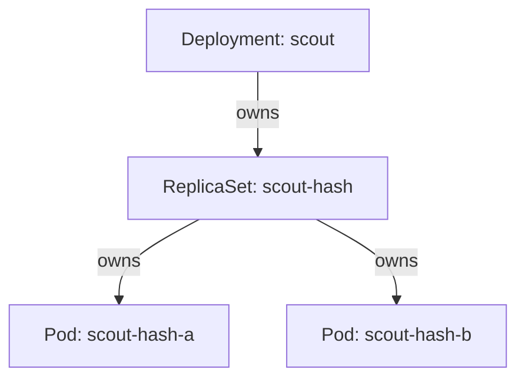

# Ownership From Deployment To Pod

When you create a Deployment, Kubernetes creates a ReplicaSet and pods that you never wrote. When you delete a pod, another one appears. Both facts come from one mechanism: objects record which object owns them, and each controller manages only the objects that it owns. This part follows that link through the three levels of the `scout` Deployment and shows the self-healing behavior at each level.

## Three controllers, three kinds of object

A **Deployment** describes a desired version of an application and how to move between versions. A **ReplicaSet** keeps a stated number of identical pods running. A **pod** is one running copy of the containers. Each level has its own controller, and each controller does one job.

- The **Deployment controller** creates and updates ReplicaSets. It never creates a pod.
- The **ReplicaSet controller** creates and deletes pods so that their count matches the ReplicaSet `spec.replicas`.
- The **kubelet** runs the containers of a pod on a node and reports the pod status.



The diagram shows ownership as a tree: one Deployment owns its ReplicaSets, and each ReplicaSet owns its pods. The tree is stored in the objects themselves, so you can read it from the API.

## ownerReferences

Every object can have a list `metadata.ownerReferences`. Each entry names an owner with four fields: `apiVersion`, `kind`, `name` and `uid`. A `uid` is a unique identifier that the API server gives to an object when it creates it. The entry also has `controller: true` when the owner is the managing controller, and `blockOwnerDeletion`, which matters when the owner is deleted with foreground deletion.

The `uid` makes the link exact. If you delete a Deployment and create a new one with the same name, the new object has a new `uid`, so the old ReplicaSet does not belong to it. Read the owner of each `scout` pod. The first command lists the pods with their owners:

<!-- astrona:playground:renew -->

```sh
kubectl -n starfleet get pods -l app=scout -o jsonpath='{range .items[*]}{.metadata.name}{" owner: "}{.metadata.ownerReferences[0].kind}{"/"}{.metadata.ownerReferences[0].name}{"\n"}{end}'
```

Each line shows a pod name and the owner `ReplicaSet/scout-` followed by a hash. The hash is the value of the label `pod-template-hash`, which the Deployment controller adds to the ReplicaSet and to its pods. Now read the owner of that ReplicaSet:

```sh
kubectl -n starfleet get replicasets -l app=scout -o jsonpath='{range .items[*]}{.metadata.name}{" owner: "}{.metadata.ownerReferences[0].kind}{"/"}{.metadata.ownerReferences[0].name}{" uid="}{.metadata.ownerReferences[0].uid}{"\n"}{end}'
```

The ReplicaSet names the Deployment `scout` as its owner. Compare the `uid` in that line with the `uid` of the Deployment itself:

```sh
kubectl -n starfleet get deployment scout -o jsonpath='{.metadata.uid}{"\n"}'
```

The two values are equal. This equality is the whole ownership link: a name alone is not enough, and the `uid` decides.

## Selectors and labels find the pods

Ownership says who manages an object. A **selector** says which objects a controller counts. A ReplicaSet counts the pods whose labels match its `spec.selector`. The Deployment controller adds the label `pod-template-hash` to the selector of each ReplicaSet it creates, so two ReplicaSets of the same Deployment never count each other's pods.

A controller uses both tools together. It lists pods with the selector, and it only manages those pods that have a `controller: true` owner reference that points to it. A pod that matches the selector but belongs to another controller is left alone. A pod that matches and has no owner can be adopted: the controller adds its own owner reference.

## Self-healing at the pod level

Delete one pod of `scout` and read what happens. The first command stores the name of the first pod, and the second deletes it:

```sh
POD_NAME=$(kubectl -n starfleet get pods -l app=scout -o jsonpath='{.items[0].metadata.name}')
kubectl -n starfleet delete pod "$POD_NAME" --wait=false
```

Then list the pods again:

```sh
kubectl -n starfleet get pods -l app=scout
```

The list shows a pod with a new name, because the ReplicaSet controller noticed that the ReplicaSet owned fewer pods than `spec.replicas` and created another one. The deleted pod can still appear for a moment with the status `Terminating`. The replacement is a different object with a new `uid`. The controller restores the count, not the old pod.

## Self-healing at the ReplicaSet level

The same rule holds one level up. Delete the ReplicaSet of `probe` and read the result:

```sh
kubectl -n starfleet delete replicaset -l app=probe
kubectl -n starfleet get replicasets,pods -l app=probe
```

The Deployment controller sees that the Deployment `probe` has no ReplicaSet for its current pod template. It creates a ReplicaSet again, and that ReplicaSet creates pods. The new ReplicaSet has the same name, because the name is built from the Deployment name and the hash of the pod template, and the template did not change. The `uid` is new.

Deleting a ReplicaSet also deletes its pods. A component called the **garbage collector** removes every object whose owner no longer exists, by following the `ownerReferences` of the pods. The pods of the old ReplicaSet carry the old `uid`, so the new ReplicaSet does not adopt them.

## Self-healing stops at the top

Nothing owns the Deployment. If you delete it, no controller creates it again, because no object holds a `spec` that asks for it. The garbage collector removes the ReplicaSet and the pods. The desired state is the object, so removing the object removes the intent. People keep Deployment YAML in a repository for this reason: the repository is the stored desired state of the objects that nothing owns.

This part showed `ownerReferences` with a `uid`, the selector that counts pods, and self-healing at two levels. The open question is how the controllers learn so fast that something changed, and what happens when they miss a change.

## Common pitfalls

> [!WARNING]
> - **Deleting a pod to "restart the Deployment".** It works, but the new pod comes from the same template. It does not change configuration.
> - **Editing a pod managed by a ReplicaSet.** Most pod fields cannot change. A new pod from the template wins over a hand edit.
> - **Matching owners by name.** Two objects with the same name can have different `uid` values. The `uid` is the link.
> - **Giving two controllers the same selector.** Overlapping selectors make controllers count and adopt each other's pods.
> - **Expecting a deleted Deployment to return.** No controller owns it, so it stays deleted.
