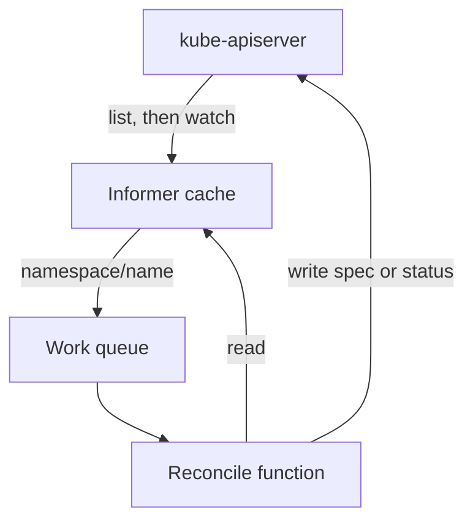

# Watches And Level-Triggered Reconciliation

A controller must learn about changes quickly, but a cluster can have thousands of objects, and a controller that lists all of them every second would overload the API server. Kubernetes solves this with a watch: the controller asks the API server to send each change as it happens. This part shows what a watch delivers, what a `resourceVersion` is for, and why a controller still compares states instead of replaying the changes it hears about.

## What a watch is

A **watch** is a long-lived HTTP request to the kube-apiserver. The server keeps the connection open and writes one line each time a matching object changes. Each line has a `type` (`ADDED`, `MODIFIED` or `DELETED`) and the full new `object`. A client such as `kubectl get --watch` or a controller uses the same mechanism.

You can read the raw stream. Open a second terminal for this part. In the first terminal, start a watch on the `probe` pods. The `timeoutSeconds` option ends the request after 40 seconds:

<!-- astrona:playground:renew -->

```sh
kubectl get --raw "/api/v1/namespaces/starfleet/pods?watch=true&labelSelector=app%3Dprobe&timeoutSeconds=40"
```

The command prints one JSON line for each event, and it prints nothing until something changes. Now, in the second terminal, delete one `probe` pod:

```sh
kubectl -n starfleet delete pod -l app=probe --wait=false
```

The watch prints `MODIFIED` events when the pod gets a deletion timestamp and when its status changes, a `DELETED` event when it is gone, and `ADDED` and `MODIFIED` events for the new pods that the ReplicaSet controller creates. The label selector in the command deletes both `probe` pods, so you see events for both of them. Each event carries the whole object, so the reader does not need a second request.

## resourceVersion

Every object has `metadata.resourceVersion`. It is an opaque string that the API server changes each time it stores the object. A client must not parse it or compare it as a number. A client may only do two things with it: send it back to the server, and check that two values are equal.

Read the value for the `scout` Deployment, change something on the object, and read it again. The first command stores the current value:

```sh
OLD_VERSION=$(kubectl -n starfleet get deployment scout -o jsonpath='{.metadata.resourceVersion}')
echo "$OLD_VERSION"
```

Add an annotation, which is a change to `metadata` only, and print the new `resourceVersion` next to the generation:

```sh
kubectl -n starfleet annotate deployment scout reviewed-by=starfleet-ops --overwrite
kubectl -n starfleet get deployment scout -o jsonpath='{.metadata.resourceVersion} {.metadata.generation}{"\n"}'
```

The `resourceVersion` is different from `OLD_VERSION`, because the object changed. The `generation` did not change, because it only counts changes to `spec`. The two counters answer different questions: `resourceVersion` says "this stored object is a new version", and `generation` says "the desired state is new".

## resourceVersion as a position and as a lock

The server uses `resourceVersion` in two ways. A list response carries a `resourceVersion` for the moment of the list. A client can start a watch from that value and receive every change after it, so no change falls between the list and the watch. Print the list value, and then watch from it:

```sh
LIST_VERSION=$(kubectl -n starfleet get pods -o jsonpath='{.metadata.resourceVersion}')
kubectl get --raw "/api/v1/namespaces/starfleet/pods?watch=true&resourceVersion=$LIST_VERSION&timeoutSeconds=15"
```

The watch prints events only for changes after `LIST_VERSION`. If nothing changes in 15 seconds, it prints nothing and ends. If the version is too old, because the server has already discarded that part of its history, the server answers with the status `410 Gone` and the client must list again.

The second use is a lock. When a client updates an object, it can send the `resourceVersion` that it read. If the stored version is different, the server rejects the update with a conflict. This is called **optimistic concurrency**: nobody holds a lock, and the loser of a race learns about it. Try it with the old value from above:

```sh
kubectl -n starfleet patch deployment scout --type=merge -p "{\"metadata\":{\"resourceVersion\":\"$OLD_VERSION\"}}"
```

The command fails with a message that says the object has been modified and that you must apply your changes to the latest version. A controller handles the same error by reading the object again and running the reconciliation again. This is why two controllers can write to the same object without overwriting each other silently.

## How a controller uses the watch

A controller does not call the API server for each event. It runs a client component called an **informer**. The informer lists the objects of a kind once, starts a watch from the list `resourceVersion`, and keeps a local cache that follows the events. Reads inside the controller come from this cache. When an event arrives, the informer does not hand the event to the reconcile function. It puts the **key** of the object, `namespace/name`, into a **work queue**.



The diagram shows that the reconcile function receives a key, reads the current object from the cache and writes changes back to the API server. The queue removes duplicates: if the same key is added five times before a worker takes it, the worker runs once.

## Level-triggered and edge-triggered

An **edge-triggered** system reacts to each change event and keeps the meaning of the events in order. A **level-triggered** system reacts to the current state and ignores how it got there. Kubernetes controllers are level-triggered.

Take one example. Someone scales `scout` from 2 to 5, then to 3, then to 4 within one second. An edge-triggered handler must apply three events in order and cannot skip one. The Deployment controller reads the key once, sees `spec.replicas: 4`, sees a ReplicaSet with 2 replicas and sets it to 4. The intermediate values never matter.

The same property makes a missed event harmless. If the watch connection breaks, the informer lists the objects again and starts a new watch. A controller that was down for ten minutes reads every object at start-up and reconciles each of them. Controllers also repeat reconciliation periodically, a **resync**, so a change that was lost for any reason is found at the next pass.

## What level-triggered logic requires

The rule has a cost: the reconcile function must make a decision from the current state alone. It must not assume "this pass is the one that follows the creation event". It must handle an object that already has some of its children, and an object whose children were partly deleted. It also follows that every action must be safe to repeat.

This part showed the watch stream, the two uses of `resourceVersion`, the informer and work queue, and the difference between levels and edges. The open question is what the controller does when the state it wants cannot be reached.

## Common pitfalls

> [!WARNING]
> - **Comparing `resourceVersion` as a number.** The value is opaque. Only equality has a meaning.
> - **Confusing `resourceVersion` with `generation`.** A label or annotation change moves the first one, not the second.
> - **Treating a watch as a complete record.** A watch can end and its history is limited. A client must be able to list again.
> - **Writing reconcile logic that needs every event.** Events can merge or be lost. The logic must work from the current state.
> - **Retrying a conflict with the old object.** After a conflict, read the latest version before the next write.
