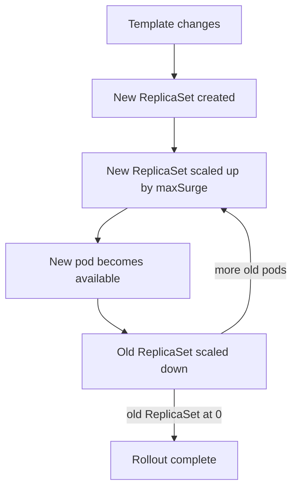

# Drift Correction And Rollouts

Objects change for reasons other than the controller: a person edits a replica count, a script scales a ReplicaSet, a node loses its pods. A cluster that stays correct has to notice and repair such changes without help. This part defines drift, shows the Deployment controller undoing it, and then follows a normal rollout, which is the same mechanism applied on purpose to a change that you do want.

## What drift is

**Drift** is a difference between the state that the owner of an object wants and the state that the object has. The difference can have several causes: a manual edit, a failed node, or another tool that writes the same field. The controller does not need to know the cause. It compares the observed state with `spec`, and any difference starts the same repair.

Drift has a direction that depends on what the controller owns. A Deployment controller owns the ReplicaSet size, so a change to `spec.replicas` on a ReplicaSet is drift, and the controller reverses it. A change to `spec.replicas` on the Deployment is not drift. It is a new desired state, and the controller follows it.

## Correct a manual change

Try it on the `probe` Deployment. The first command stores the name of its ReplicaSet. The second scales that ReplicaSet to 5 replicas, which bypasses the Deployment:

<!-- astrona:playground:renew -->

```sh
REPLICASET_NAME=$(kubectl -n starfleet get replicasets -l app=probe -o jsonpath='{.items[0].metadata.name}')
kubectl -n starfleet scale replicaset "$REPLICASET_NAME" --replicas=5
```

The API server accepts the change, because a ReplicaSet is a normal object. The ReplicaSet controller reacts first: it sees 5 desired pods and creates three more. The Deployment controller reacts to the same change. It finds that the ReplicaSet size (5) is different from `spec.replicas` of the Deployment (2) and sets the ReplicaSet back to 2. The ReplicaSet controller then deletes three pods. Read the result after a few seconds:

```sh
kubectl -n starfleet get replicaset "$REPLICASET_NAME" -o jsonpath='{.spec.replicas}{"\n"}'
kubectl -n starfleet get events --field-selector involvedObject.kind=Deployment,involvedObject.name=probe
```

The first command prints `2`. The second lists events from the Deployment controller with the reason `ScalingReplicaSet`, which record the scale-down. The events are the history of what the controller did, and the order of the two scale steps shows that the controller reacted to the change instead of preventing it. The cluster briefly had extra pods before it settled.

## A rollout is the same loop on a new template

A **rollout** is the controlled move from one pod template to another. A Deployment keeps one ReplicaSet for each pod template. A change to `spec.template` creates a new ReplicaSet, and the Deployment controller moves the replicas from the old ReplicaSet to the new one in small steps. A change to the replica count does not create a new ReplicaSet.

Two settings in `spec.strategy.rollingUpdate` set the step size. `maxSurge` is how many pods above `spec.replicas` may exist during the rollout. `maxUnavailable` is how many pods below `spec.replicas` may be unavailable. Both default to 25 percent. Surge rounds up and unavailable rounds down, so with two replicas the rollout may add one pod and may not remove an available pod before the new one is ready.



The diagram shows that the controller alternates between scaling up the new ReplicaSet and scaling down the old one, and that it waits for availability before it removes old pods. This wait is what keeps the service up.

## Run a rollout

Change the pod template of `probe` by adding an environment variable. Any template change causes a rollout:

```sh
kubectl -n starfleet set env deployment/probe LOG_LEVEL=debug
kubectl -n starfleet rollout status deployment/probe
```

The second command waits and prints progress lines until the Deployment is complete. It exits with a non-zero code if the rollout does not finish. Then list the ReplicaSets and the revision history:

```sh
kubectl -n starfleet get replicasets -l app=probe
kubectl -n starfleet rollout history deployment/probe
```

The Deployment now has two ReplicaSets. The new one has 2 replicas and the old one has 0, and the old one stays in the cluster. The history lists two revisions. The Deployment keeps the old ReplicaSets so that a rollback has something to go back to. The field `revisionHistoryLimit`, which defaults to 10, sets how many it keeps.

## Roll back by returning to an old template

Return to the earlier version:

```sh
kubectl -n starfleet rollout undo deployment/probe
kubectl -n starfleet rollout status deployment/probe
```

The command does not restore a snapshot. It copies the pod template of the previous revision back into `spec.template`. The new template is equal to the one in the old ReplicaSet, so the Deployment controller finds that ReplicaSet by its template hash, scales it up and scales the other one down. The controller then labels the reused ReplicaSet with a new, higher revision number.

## Why every action can be repeated

A controller can be interrupted at any point and can run the same pass twice. The actions are therefore **idempotent**: running them again leaves the cluster in the same state as running them once. Look at the difference with a ConfigMap. Save this as `configmap-fleet-notes.yaml`:

```yaml
apiVersion: v1
kind: ConfigMap
metadata:
  name: fleet-notes
  namespace: starfleet
data:
  owner: starfleet-ops
```

Apply it twice:

```sh
kubectl apply -f configmap-fleet-notes.yaml
kubectl apply -f configmap-fleet-notes.yaml
```

The first run prints that the ConfigMap was created, and the second prints that it is unchanged. The command `kubectl create` with the same file fails the second time with an `AlreadyExists` error. Controllers use the first style: they describe the object that should exist, and they treat "already exists with the right content" as success. Setting the replica count of a ReplicaSet to 2 is idempotent. "Add one pod" is not.

One more mechanism protects the repeat. The ReplicaSet controller records how many pod creations and deletions it has requested and not yet seen in its cache. It waits to see them before it counts again. This is called an **expectation**, and it stops the controller from creating a second batch of pods because its cache was one moment behind.

This part showed drift being reversed, a rollout through two ReplicaSets, a rollback, and idempotent actions. The open question is how a user can tell that a rollout is still in progress, finished or stuck.

## Common pitfalls

> [!WARNING]
> - **Fixing drift in the wrong layer.** Editing a ReplicaSet or a pod is reversed by its owner. Change the Deployment.
> - **Expecting a template change from a scale.** Only a change to `spec.template` creates a new ReplicaSet.
> - **Deleting old ReplicaSets with zero pods.** They are the rollback history. Delete them only on purpose.
> - **Believing `rollout undo` restores a saved copy.** It writes the earlier template into `spec.template` again.
> - **Writing a script step that is not repeatable.** A step that appends or increments gives a different result when it runs twice.
