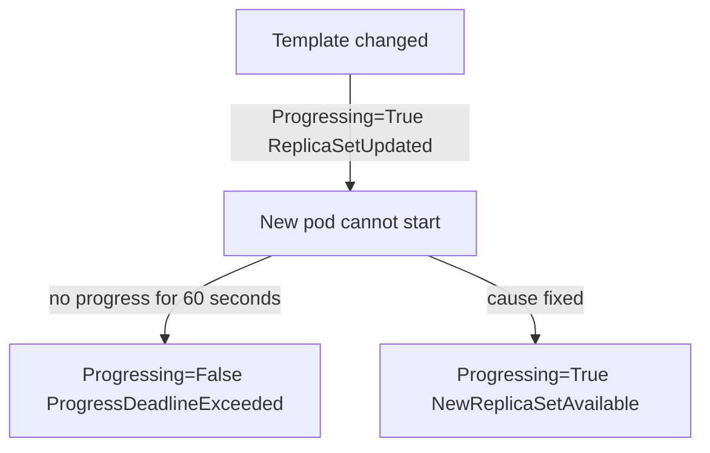

# Conditions And Progress Deadlines

A counter such as `readyReplicas: 2` says how much work is done, but not whether the controller is making progress or is stuck. Kubernetes adds a second kind of status for that: conditions. A condition is a named fact with a status, a reason and a message, and tools read it to decide whether to wait, succeed or fail. This part reads the conditions of a Deployment in three situations: converged, rolling out and stuck.

## The shape of a condition

Most Kubernetes objects report `status.conditions`. Each entry has these fields:

- `type`: the name of the fact, for example `Available`.
- `status`: `True`, `False` or `Unknown`.
- `reason`: a short, machine-readable word in CamelCase, for example `MinimumReplicasAvailable`.
- `message`: a sentence for people.
- `lastTransitionTime`: when `status` last changed.
- `lastUpdateTime`: when the controller last wrote the condition (for Deployments).

Scripts and tools use `type`, `status` and `reason`. The `message` is for reading and can change between versions. A condition is a level, not an event: it says what is true now, and it is replaced when the situation changes.

## The Deployment conditions

A Deployment has up to three condition types. **Available** is `True` when the number of available replicas is at least `spec.replicas` minus `maxUnavailable`. Its reasons are `MinimumReplicasAvailable` and `MinimumReplicasUnavailable`. **Progressing** says whether the rollout moves forward. **ReplicaFailure** appears as `True` with the reason `FailedCreate` when the ReplicaSet cannot create pods, for example because a quota is exceeded.

Progressing has several reasons. `NewReplicaSetCreated` and `FoundNewReplicaSet` appear when a rollout starts. `ReplicaSetUpdated` appears while it runs. `NewReplicaSetAvailable` means the rollout completed, and the new ReplicaSet is the current one. `ProgressDeadlineExceeded` has the status `False` and means the rollout did not progress in time. A paused Deployment reports `DeploymentPaused` with the status `Unknown`.

Read the conditions of the converged `probe` Deployment:

<!-- astrona:playground:renew -->

```sh
kubectl -n starfleet get deployment probe -o jsonpath='{range .status.conditions[*]}{.type}{"="}{.status}{" "}{.reason}{"\n"}{end}'
```

The output has one line for each condition. For a Deployment that completed, `Available` is `True` with `MinimumReplicasAvailable`, and `Progressing` is `True` with `NewReplicaSetAvailable`. If you ran a rollout in the playground before, `Progressing` can show the same reason with a newer time.

## The progress deadline

Without a limit, a rollout that cannot finish would stay in progress forever. The field `spec.progressDeadlineSeconds` sets the limit. The default is 600 seconds, and the playground sets 60 so that you do not wait ten minutes. Read it:

```sh
kubectl -n starfleet get deployment probe -o jsonpath='{.spec.progressDeadlineSeconds}{"\n"}'
```

The controller restarts the timer each time the Deployment makes progress. Progress means that it created a ReplicaSet, scaled a ReplicaSet, or that new pods became ready. If the timer runs out with no progress, the controller sets `Progressing` to `False` with the reason `ProgressDeadlineExceeded` and writes an event.

The deadline reports a problem. It does not change the rollout. The controller keeps trying, it does not roll back, and it does not delete the new ReplicaSet. If the cause is fixed later, the rollout continues and `Progressing` returns to `True`. Rolling back is an action that a person or a pipeline takes after reading the condition.

## Break a rollout and read the conditions

Set the image of `probe` to a tag that does not exist:

```sh
kubectl -n starfleet set image deployment/probe probe=mccutchen/go-httpbin:2.25.0-does-not-exist
```

The Deployment controller creates a new ReplicaSet and scales it up by `maxSurge`, which is one pod. The pod cannot pull its image. The old ReplicaSet keeps its two pods, because `maxUnavailable` rounds down to 0 for two replicas. Read the counters at once:

```sh
kubectl -n starfleet get deployment probe
```

The table shows `READY` as `2/2`, `UP-TO-DATE` as `1` and `AVAILABLE` as `2`. The `UP-TO-DATE` column counts pods of the newest template. `AVAILABLE` stays at 2 because the old pods still run. The next diagram shows the states that the Deployment moves through.



The diagram shows the two ways out of the stalled state: the timer expires and the condition changes, or the cause is fixed and the rollout completes. Now ask the `rollout status` command, and let it wait for 90 seconds:

```sh
kubectl -n starfleet rollout status deployment/probe --timeout=90s
```

The command prints a line that says it is waiting for the rollout to finish, and then it ends with an error that says the Deployment exceeded its progress deadline. It exits with a non-zero code, which is how a pipeline step detects the failure. Read the conditions again:

```sh
kubectl -n starfleet get deployment probe -o jsonpath='{range .status.conditions[*]}{.type}{"="}{.status}{" "}{.reason}{"\n"}{end}'
```

`Progressing` is now `False` with `ProgressDeadlineExceeded`. `Available` is still `True`, because the old pods serve requests. Check that the service still works:

```sh
kubectl -n starfleet exec deploy/shuttle -- curl -s -o /dev/null -w '%{http_code}\n' http://probe.starfleet.svc.cluster.local/get
```

The command prints `200`. This is the safety of a rolling update: a blocked rollout leaves the available pods in place. It also shows why `Available` alone is a weak signal for a release, because it was `True` through the whole failure.

## Recover and read the conditions again

Return to the earlier template:

```sh
kubectl -n starfleet rollout undo deployment/probe
kubectl -n starfleet rollout status deployment/probe --timeout=90s
```

The Deployment controller reuses the ReplicaSet with the working template and scales the broken one down to zero. `Progressing` returns to `True` with `NewReplicaSetAvailable`. The broken ReplicaSet stays in the history with 0 replicas. Read it again if you want the evidence: the broken template is still stored in it.

## Reading conditions in a script

A tool that waits for a result should wait on the condition and also check `observedGeneration`. This command waits until the Deployment has the `Available` condition set to `True`, with a limit of 60 seconds:

```sh
kubectl -n starfleet wait --for=condition=Available deployment/probe --timeout=60s
```

The command succeeds when the condition is `True`. For a rollout, `rollout status` is better, because it also compares the generation and the counters of updated and available replicas, and it understands the progress deadline.

This part read the three Deployment conditions, the progress deadline and the way a stuck rollout changes `Progressing` while `Available` stays `True`. The open question is how to find the cause: the condition says that the rollout is stuck, not why.

## Common pitfalls

> [!WARNING]
> - **Trusting `Available` during a rollout.** The old pods keep it `True` while the new version fails.
> - **Expecting an automatic rollback.** The controller reports `ProgressDeadlineExceeded` and keeps trying.
> - **Parsing the `message`.** The text can change. Use `type`, `status` and `reason`.
> - **Setting a very short deadline.** A slow image pull or a long readiness delay can trip it. Choose a value above the normal start time.
> - **Reading conditions without `observedGeneration`.** A condition can describe the previous `spec`.
