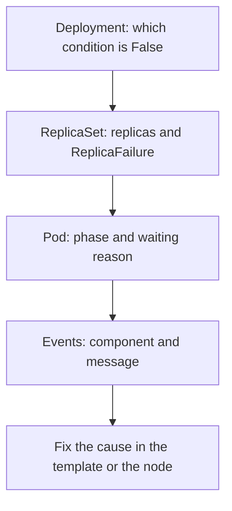

# Reading Blocked Progress

When a Deployment does not converge, the condition `Progressing=False` only says that something is wrong. The cause sits one or two levels lower: in a ReplicaSet, in a pod, or in an event that a component wrote. This part gives a fixed order for reading those levels, applies it to two different failures, and explains the retry back-off that makes a failure look slow.

## The reading order

Read from the object that you changed down to the object that failed. Each step has one question and one command.

1. **Deployment.** Is `observedGeneration` current, and which condition is `False`?
2. **ReplicaSet.** Does the new ReplicaSet have the replicas that it should have? A `ReplicaFailure` condition here means that pod creation was refused, for example by a quota.
3. **Pod.** Which phase does the pod have, and why? A container in the state `waiting` has a `reason`.
4. **Events.** Which component wrote a warning, and what does it say?
5. **Logs.** Only when a container started and then failed.

The order matters because a lower level shows facts that the higher level cannot: a Deployment knows how many pods are unavailable, but only the pod knows whether the image could not be pulled or the pod could not be placed on a node.

## Events

An **event** is an object that a component writes to record something it did or saw. Each event has a `reason`, a `message`, the object it is about (`involvedObject`), a `type` of `Normal` or `Warning`, and a count that rises when the same event repeats. The scheduler, the kubelet and the controllers all write events. The API server keeps them for about one hour by default.

Events are for people. They are not a reliable record, because they expire and the component can merge or drop them. Automation should read conditions and `status`, and use events to explain a failure.

## Failure one: the image cannot be pulled

Change the image of `scout` to a tag that does not exist:

<!-- astrona:playground:renew -->

```sh
kubectl -n starfleet set image deployment/scout scout=ghcr.io/stefanprodan/podinfo:6.15.0-does-not-exist
```

The new ReplicaSet creates a pod, and the scheduler places it on the node. The kubelet then tries to pull the image and fails. List the pods after a few seconds:

```sh
kubectl -n starfleet get pods -l app=scout
```

The old pods are `Running`. The new pod has the status `ErrImagePull` and then `ImagePullBackOff`. These words come from the kubelet and are written into `status.containerStatuses[].state.waiting.reason` of the pod. Print the pod events with `kubectl describe` and read the last lines of the output:

```sh
kubectl -n starfleet describe pods -l app=scout
```

The `Events` section of the new pod lists the entries in order: `Scheduled` from the scheduler, `Pulling` from the kubelet, `Failed` with the message that the pull did not succeed, and `BackOff` with the message that the kubelet is waiting before it pulls again. The reading order found the cause at the pod level after the Deployment level only said "not progressing". The error text from the registry is part of the `Failed` message, for example that the tag was not found.

## Failure two: the pod cannot be placed

Return to the working template and then set a CPU request that no node can satisfy. A container request must not exceed its limit, so the patch sets both:

```sh
kubectl -n starfleet rollout undo deployment/scout
kubectl -n starfleet patch deployment scout -p '{"spec":{"template":{"spec":{"containers":[{"name":"scout","resources":{"requests":{"cpu":"1000"},"limits":{"cpu":"1000"}}}]}}}}'
```

The first command reuses the working ReplicaSet. The second changes the template again, so a new ReplicaSet creates a new pod. The scheduler cannot find a node with 1000 CPU cores, so the pod stays in the phase `Pending`. Read the pod condition that the scheduler writes:

```sh
kubectl -n starfleet get pods -l app=scout -o jsonpath='{range .items[*]}{.metadata.name}{" "}{.status.phase}{" "}{.status.conditions[?(@.type=="PodScheduled")].reason}{"\n"}{end}'
```

The new pod shows `Pending` and the reason `Unschedulable`. The matching event comes from the scheduler with the reason `FailedScheduling`. Its message says how many nodes were checked and why each one failed, and it contains the words `Insufficient cpu`. The Deployment conditions look the same as in the first failure, but the component and the cause are different: here no kubelet is involved, because no node was chosen.

## A third case: running, but not ready

A pod can run and still not be ready. If the readiness probe of `probe` pointed at a path that returns a 404, the pod would have the phase `Running` and `READY` `0/1`. The kubelet writes an event with the reason `Unhealthy` and a message that the readiness probe failed with a status code. The Service removes the pod from its endpoints, and the Deployment counts it as not available. A container that starts and then exits shows `CrashLoopBackOff` instead, and its logs, read with `kubectl logs --previous`, are the next place to look.

## Why failures look slow: back-off

A component that retries a failed action at full speed would flood the API server and the registry. Each retry therefore waits longer than the one before. This is **exponential back-off**.

The kubelet waits 10 seconds after the first failed image pull or container start, doubles the wait after each failure, and stops at 5 minutes. A container that runs for 10 minutes without failing resets the wait. Controllers do the same for reconcile errors: a failed key goes back to the work queue with a growing delay, and a success clears the delay.

The result is that a fix does not take effect at once for a pod that is already in back-off. The pod waits for its next retry, which can be minutes away. A template change avoids the wait because it creates a new pod, which has no history. This is also why a rollout that blocks for a long time can recover slowly after the cause is fixed.

## Putting the order together



The diagram shows the order of the reading steps and that the fix goes into the Deployment template, which creates a new ReplicaSet.

Restore the working template so that the cluster is healthy again:

```sh
kubectl -n starfleet rollout undo deployment/scout
kubectl -n starfleet rollout status deployment/scout --timeout=120s
```

This part gave a reading order, applied it to a failed image pull and an unschedulable pod, named a not-ready pod, and explained back-off. The open question is how an object is removed when something else still depends on it.

## Common pitfalls

> [!WARNING]
> - **Reading only the Deployment.** The Deployment shows that progress stopped. The pod and its events show why.
> - **Treating events as permanent.** They expire after about an hour, so copy the text you need as evidence.
> - **Confusing the two Pending causes.** A pod that is `Pending` before a node is chosen is a scheduler problem. A pod that is `Pending` or waiting after it is placed is a kubelet problem.
> - **Waiting for a pod in back-off.** After you fix the cause, a template change gives a new pod and skips the wait.
> - **Setting a request above the limit.** The API server rejects it. Change both values together.
