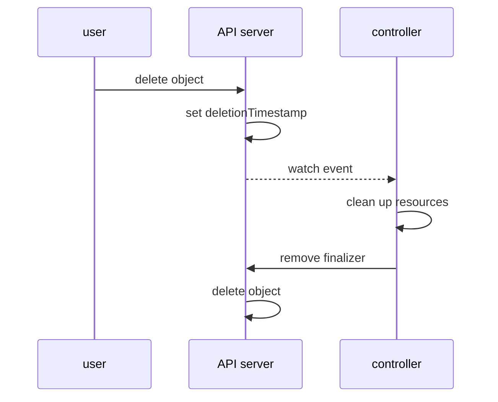

# Finalizers And Garbage Collection

Creating an object is one step. Deleting it can be several: a pod must stop its containers, a Deployment must remove its ReplicaSets, and a controller that created a resource outside the cluster must remove that resource too. Kubernetes handles this with two mechanisms: the garbage collector, which follows `ownerReferences`, and finalizers, which keep an object in the API until a controller has finished its cleanup. This part shows both on small objects, and shows what happens when the cleanup never finishes.

## What happens on a delete request

A request to delete an object does not always remove it. The API server checks the field `metadata.finalizers`. A **finalizer** is a string in that list. It means "a controller still has work to do before this object may go away". If the list is empty, the API server deletes the object at once. If the list has entries, the API server sets `metadata.deletionTimestamp` and leaves the object in place.

An object with a `deletionTimestamp` is **terminating**. It is still visible and readable. Nobody can clear the timestamp, and nobody can add a new finalizer to it. The controller that owns a finalizer watches for the timestamp, does its cleanup, and then removes its own entry from the list. When the list is empty, the API server deletes the object.



The diagram shows that the API server only marks the object, and the controller finishes the deletion by removing its finalizer. The cleanup must be idempotent, because the controller can run the same pass more than once.

## Hold an object with a finalizer

The name of a finalizer is a qualified string that the owning controller picks, such as `starfleet.example.com/cleanup`. Kubernetes does not check what it means. No controller runs here, so the finalizer holds the object until you remove it. Save this as `configmap-beacon.yaml`:

<!-- astrona:playground:renew -->

```yaml
apiVersion: v1
kind: ConfigMap
metadata:
  name: beacon
  namespace: starfleet
  finalizers:
    - starfleet.example.com/cleanup
data:
  site: outpost
```

Apply it, and then ask for its deletion without waiting:

```sh
kubectl apply -f configmap-beacon.yaml
kubectl -n starfleet delete configmap beacon --wait=false
```

The delete command prints that the ConfigMap was deleted, but the object is still there. Read the two fields that show why:

```sh
kubectl -n starfleet get configmap beacon -o jsonpath='{.metadata.deletionTimestamp}{" "}{.metadata.finalizers}{"\n"}'
```

The output has a time stamp and the list with `starfleet.example.com/cleanup`. The object is terminating, and the finalizer is the only thing that holds it. In a real system, a controller would now remove an external resource and then remove the finalizer. Here you act as that controller. Remove the finalizer with a merge patch:

```sh
kubectl -n starfleet patch configmap beacon --type=merge -p '{"metadata":{"finalizers":null}}'
kubectl -n starfleet get configmap beacon
```

The second command reports that the ConfigMap is not found, because the list became empty and the API server deleted the object. Removing a finalizer by hand skips the cleanup that it stands for. If a controller used the finalizer to remove a database or a cloud resource, that resource stays behind. Remove a finalizer only after you have checked that the work is done or is not needed.

## Why an object stays terminating

An object that stays in the terminating state has a finalizer whose owner does not run. The usual causes are a controller that was uninstalled before its objects were deleted, a controller that fails on the cleanup and retries with back-off, and a cleanup that waits for another resource. A namespace that does not finish deleting follows the same rule: it holds its own finalizer until every object inside it is gone, and a single object with a stuck finalizer blocks it.

The diagnosis uses the same tools as for any blocked object. Read `deletionTimestamp` and `finalizers` on the object, find the component that owns the finalizer by its name, and read that component's events and logs.

## Garbage collection

The **garbage collector** is a controller in the kube-controller-manager. It builds a graph from every `ownerReferences` entry. When an object is deleted, it finds the objects that depend on it and deletes those that have no other owner left. This is how deleting a Deployment removes its ReplicaSets and pods.

A delete request carries a **propagation policy**, which `kubectl` sets with `--cascade`:

- `background` is the default. The owner is deleted at once, and the garbage collector deletes the dependents afterward.
- `foreground` keeps the owner, with a `foregroundDeletion` finalizer, until the dependents that have `blockOwnerDeletion: true` are gone.
- `orphan` deletes the owner and removes the owner reference from the dependents, so they stay.

An owner and its dependent must be in the same namespace, or the owner must be a cluster-scoped object. A namespaced owner cannot have dependents in another namespace.

## Orphan the dependents

Create a Deployment for the experiment. Use a separate one, so that `scout` and `probe` stay intact:

```sh
kubectl -n starfleet create deployment relay --image=mccutchen/go-httpbin:2.25.0 --replicas=2
kubectl -n starfleet rollout status deployment/relay
```

Delete the Deployment but keep its dependents, and look at the ReplicaSet that stays behind:

```sh
kubectl -n starfleet delete deployment relay --cascade=orphan
kubectl -n starfleet get replicasets,pods -l app=relay -o jsonpath='{range .items[*]}{.kind}{" "}{.metadata.name}{" owners="}{.metadata.ownerReferences}{"\n"}{end}'
```

The ReplicaSet and the pods are still there. The ReplicaSet no longer lists the Deployment as an owner, because the garbage collector removed the reference. The pods still list the ReplicaSet, which still exists. The ReplicaSet controller keeps the pods running, and nothing manages the ReplicaSet. Remove the leftovers. Deleting the ReplicaSet in the default mode deletes its pods as well:

```sh
kubectl -n starfleet delete replicaset -l app=relay
kubectl -n starfleet get pods -l app=relay
```

The garbage collector follows the pod owner references to the deleted ReplicaSet and removes the pods, so the list is empty or shows pods that are terminating.

## Where this matters for platforms

A platform that offers its own API objects uses the same two mechanisms. The objects that a controller creates for a request carry an owner reference to the request object, so deleting the request deletes them. The controller adds a finalizer to the request so that it can remove resources that live outside the cluster, which the garbage collector cannot see. The rules from this part apply unchanged: the cleanup must be repeatable, an object stays terminating until the finalizer is gone, and a missing controller leaves requests stuck.

This part showed how a delete request becomes a `deletionTimestamp`, how a finalizer holds an object, and how the garbage collector and the cascade modes remove dependents.

## Common pitfalls

> [!WARNING]
> - **Removing a finalizer to "fix" a stuck delete.** It skips the cleanup and can leave external resources behind. Check the owner first.
> - **Uninstalling a controller before deleting its objects.** The objects keep a finalizer that nobody removes.
> - **Using `--cascade=orphan` by accident.** The dependents keep running and nothing manages them.
> - **Expecting `--wait=false` to mean deleted.** The request was accepted, and the object can still be terminating.
> - **Setting an owner reference across namespaces.** The garbage collector treats the owner as missing and can delete the dependent.
