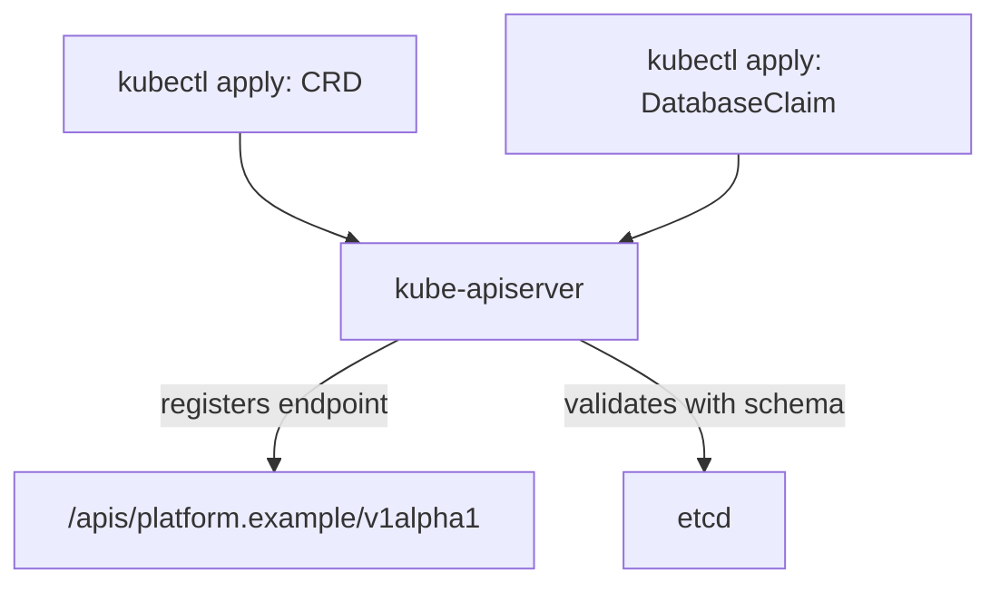

# CRD Anatomy And Scope

Every kind that Kubernetes knows, such as Pod or Deployment, is served by the API server at a fixed address and described by a schema. A platform team that wants developers to request a database with `kubectl apply` needs a new kind in the same way. This part shows what a CustomResourceDefinition (CRD) contains, what the API server does when it receives one, and how the scope of the new kind decides where tenants can create objects.

## What a CRD is

A **CustomResourceDefinition** is an object of the kind `CustomResourceDefinition` in the API group `apiextensions.k8s.io/v1`. It declares a new resource type: its group, its names, its versions and the schema of its objects. An object of the new type is called a **custom resource** (CR). The CRD is the API definition, and the custom resources are the data that follow the definition.

The component that does the work is the **kube-apiserver**. It contains an extension component that watches CRDs. When you create a CRD, the API server registers a new REST endpoint, starts to validate requests against the schema and stores each accepted object in etcd, the cluster key-value database. No controller, no Pod and no container run for the CRD. This matters later: a CRD defines an API, and it does not define what happens after an object is stored.



The diagram shows that the same API server accepts both the CRD and the custom resources, and that it writes to etcd only after the schema check passes.

## The fields of a CRD

The table lists the fields that every CRD needs. Read it once, then see them in a file.

| Field | Meaning |
| --- | --- |
| `metadata.name` | Must be `<plural>.<group>`. The API server rejects any other name. |
| `spec.group` | The API group, written as a domain name that the platform team controls, such as `platform.example`. |
| `spec.names.kind` | The kind that appears in `kind:` of an object, in CamelCase: `DatabaseClaim`. |
| `spec.names.plural` | The lower-case plural used in URLs and by `kubectl get`: `databaseclaims`. |
| `spec.names.singular`, `shortNames`, `categories` | Optional names. A short name such as `dbc` saves typing. A category such as `platform` lets `kubectl get platform` list several kinds together. |
| `spec.scope` | `Namespaced` or `Cluster`. |
| `spec.versions` | A list of versions. Each has `name`, `served`, `storage` and a `schema`. |

The group suffixes `.k8s.io` and `.kubernetes.io` are reserved for the Kubernetes project, so a platform team uses its own domain. In `apiextensions.k8s.io/v1`, every version must carry a schema. The older `v1beta1` API allowed a CRD without one, and that option is gone.

## Namespaced or cluster scope

The **scope** decides whether an object lives inside a namespace. A namespaced resource has one set of names per namespace, and Role-based access control (RBAC) can grant access one namespace at a time. A cluster-scoped resource has one global set of names, and access needs a ClusterRole.

A self-service API for tenants is almost always `Namespaced`. Each tenant team owns a namespace, creates claims there, and cannot see the claims of another team. A `Cluster` scope fits objects that belong to the whole platform, such as a catalog of allowed database engines. You cannot change the scope of an existing CRD, so decide before you publish the API.

## Create a first CRD

Start with the smallest useful CRD. It accepts any content under `spec`, so you can see the API work before you add rules. The field `x-kubernetes-preserve-unknown-fields: true` tells the API server not to remove fields that the schema does not list. The next part replaces it with a real schema.

<!-- astrona:playground:renew -->

Save this as `crd-databaseclaim-open.yaml`:

```yaml
apiVersion: apiextensions.k8s.io/v1
kind: CustomResourceDefinition
metadata:
  name: databaseclaims.platform.example
spec:
  group: platform.example
  scope: Namespaced
  names:
    kind: DatabaseClaim
    listKind: DatabaseClaimList
    plural: databaseclaims
    singular: databaseclaim
    shortNames:
      - dbc
  versions:
    - name: v1alpha1
      served: true
      storage: true
      schema:
        openAPIV3Schema:
          type: object
          properties:
            spec:
              type: object
              x-kubernetes-preserve-unknown-fields: true
```

Apply it:

```sh
kubectl apply -f crd-databaseclaim-open.yaml
```

Then wait until the API server reports that the new endpoint works:

```sh
kubectl wait --for=condition=Established crd/databaseclaims.platform.example --timeout=60s
kubectl api-resources --api-group=platform.example
```

The CRD has the status condition `Established` when the API server serves the endpoint. The second command lists the new resource with its short name `dbc`, its kind `DatabaseClaim` and the value `true` in the NAMESPACED column. A condition `NamesAccepted` also appears in `kubectl get crd databaseclaims.platform.example -o yaml`; it is `False` when another CRD already uses one of the names.

## Create custom resources

Now a tenant can create an object. Save this as `databaseclaim-scout-db.yaml`:

```yaml
apiVersion: platform.example/v1alpha1
kind: DatabaseClaim
metadata:
  name: scout-db
  namespace: starfleet
spec:
  engine: postgres
  storageGB: 20
```

Apply it and read it back:

```sh
kubectl apply -f databaseclaim-scout-db.yaml
kubectl get dbc -n starfleet
```

The list shows `scout-db` with its age. The `NAME` and `AGE` columns are the defaults when the CRD defines no printer columns. Because the scope is `Namespaced`, `kubectl get dbc -n outpost` shows nothing, and `kubectl get dbc -A` lists the claims of every namespace you may read.

Next, save a second claim with a value that a real platform would refuse, as `databaseclaim-drifter-db.yaml`:

```yaml
apiVersion: platform.example/v1alpha1
kind: DatabaseClaim
metadata:
  name: drifter-db
  namespace: outpost
spec:
  engine: oracle
  storageGB: 0
```

Apply it:

```sh
kubectl apply -f databaseclaim-drifter-db.yaml
```

The API server accepts it, because the schema allows any `spec`. This is the weakness of an open CRD: the claim reaches etcd with a database engine that the platform does not offer and a size of zero. Any controller that reads the claim later has to deal with it. The next part moves that check to the API server.

## The endpoint behind the kind

You can see the REST path that the CRD created. The raw request below asks the API server for the discovery document of the group:

```sh
kubectl get --raw /apis/platform.example/v1alpha1
```

The response is JSON. It lists a resource named `databaseclaims` with `namespaced: true`, the kind `DatabaseClaim` and the verbs the API server supports, such as `create`, `get`, `list`, `watch`, `update`, `patch` and `delete`. The verbs are the same for every CRD. RBAC rules later use the group `platform.example` and the resource `databaseclaims` to grant them.

## Deleting a CRD deletes its objects

The CRD and its custom resources are linked. Deleting the CRD removes the endpoint and every stored custom resource of that kind in every namespace. A platform team that deletes the CRD to "fix" a schema therefore deletes all tenant claims. To change a schema you apply an updated CRD, and the API server keeps the stored objects.

This part defined a new kind, saw the API server serve it without any controller, and stored two claims, one of which is not sensible. The open question is how the schema can reject the second claim.

## Common pitfalls

> [!WARNING]
> - **A wrong CRD name.** `metadata.name` must equal `<plural>.<group>`. A mismatch is rejected when you apply the file.
> - **Choosing the wrong scope.** The scope cannot change later. A tenant API that is `Cluster` scoped exposes every claim to every tenant that can read it.
> - **Deleting the CRD to change it.** This deletes all custom resources of the kind. Apply the changed CRD instead.
> - **Using a group you do not own.** Use a domain name of your organization. Names that end in `.k8s.io` or `.kubernetes.io` are reserved.
> - **Reading a successful apply as a working platform.** The API server stores the object. Nothing creates a database.
