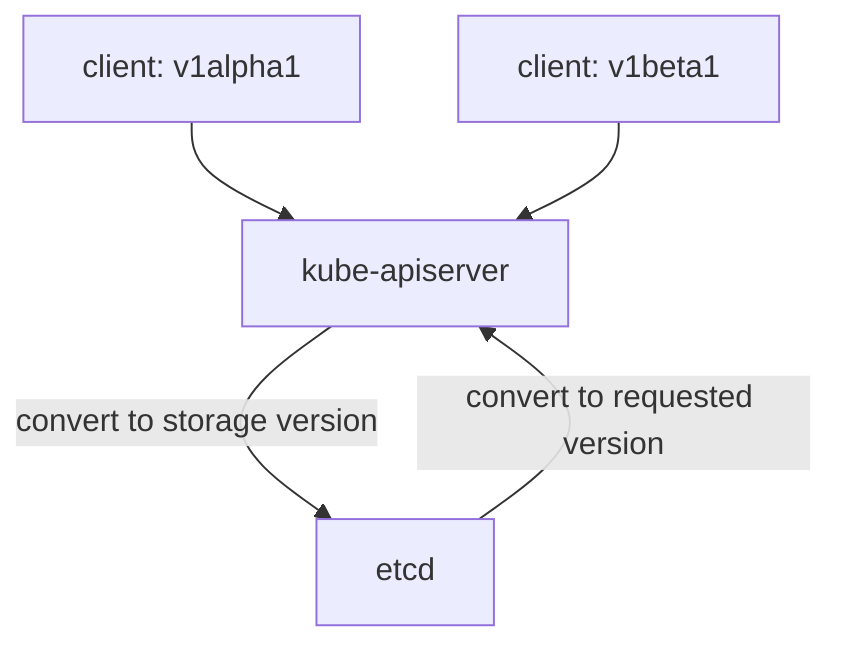

# Served And Stored Versions, Deprecation And Conversion

A platform API lives for years. The first version has fields that turn out to be wrong, and tenants have already written files against it. The platform team must be able to publish a better version, keep the old one working for a while, and tell tenants to move. This part shows how a CRD does that with served and stored versions, deprecation warnings and the conversion strategy.

## One API, several versions

The list `spec.versions` of a CRD can hold more than one entry. Each entry is a version of the same kind, such as `v1alpha1` and `v1beta1`, and each has its own schema. Three flags control how a version behaves:

- `served` decides whether the API server offers the version at a REST endpoint. A client can read and write objects through a served version.
- `storage` decides which version the API server uses to write objects into etcd. Exactly one version must have `storage: true`.
- `deprecated` marks a version that clients should stop using. The API server still serves it.

The playground starts with a `DatabaseClaim` CRD that has two versions with the same schema. `v1alpha1` is served and is the storage version. `v1beta1` is served and is not the storage version. Both carry the schema, the rules and the status subresource from the earlier work on this API.



The diagram shows that the API server converts each request to the storage version before it writes, and converts back to the requested version when it reads.

## Create an object and read it in both versions

Save this claim as `databaseclaim-scout-db.yaml`. It uses the older version:

<!-- astrona:playground:renew -->

```yaml
apiVersion: platform.example/v1alpha1
kind: DatabaseClaim
metadata:
  name: scout-db
  namespace: starfleet
spec:
  engine: postgres
  storageGB: 20
```

Apply it:

```sh
kubectl apply -f databaseclaim-scout-db.yaml
```

Then read the same object through each version. The resource name `databaseclaims.v1beta1.platform.example` has the form `<plural>.<version>.<group>`, and it tells `kubectl` which version to request:

```sh
kubectl get databaseclaims.v1alpha1.platform.example scout-db -n starfleet -o jsonpath='{.apiVersion}{"\n"}'
kubectl get databaseclaims.v1beta1.platform.example scout-db -n starfleet -o jsonpath='{.apiVersion}{"\n"}'
```

The first command prints `platform.example/v1alpha1` and the second prints `platform.example/v1beta1`. There is one object in etcd, and the API server presents it in the version that the client asks for. The second answer is the result of a conversion.

## The conversion strategy

**Conversion** is the step that turns an object from one version into another. The CRD field `spec.conversion.strategy` selects how. It has two values.

With `None`, the API server only changes the `apiVersion` field and leaves every other field as it is. This is the default, and the playground CRD sets it explicitly. It works when the schemas of the versions are compatible: the same field names, the same types, and at most new optional fields.

With `Webhook`, the API server sends the object to a service that you run, and the service returns the converted object. You need it when a field is renamed, moved or split between versions. The webhook is a running component with a certificate and a Service, so it adds an operational cost that `None` does not have. This module uses `None` only.

The consequence for API design is simple. When you use `None`, change a version by adding optional fields with defaults, and never rename or remove a field in place. A breaking change needs a new kind or a conversion webhook.

## Move the storage version

The older version is still the storage version, so etcd holds the claim in the `v1alpha1` form. Read the record that the CRD keeps:

```sh
kubectl get crd databaseclaims.platform.example -o jsonpath='{.status.storedVersions}{"\n"}'
```

The command prints `["v1alpha1"]`. The field `status.storedVersions` lists every version that may have written objects to etcd. The API server adds a version to this list when it becomes a storage version, and it never removes one by itself.

To make `v1beta1` the storage version, change both flags in one request. If you did it in two requests, the CRD would for a moment have no storage version or two. Save this as `crd-patch-storage.yaml`:

```yaml
- op: replace
  path: /spec/versions/0/storage
  value: false
- op: replace
  path: /spec/versions/1/storage
  value: true
```

Apply it:

```sh
kubectl patch crd databaseclaims.platform.example --type=json --patch-file crd-patch-storage.yaml
kubectl get crd databaseclaims.platform.example -o jsonpath='{.status.storedVersions}{"\n"}'
```

The list now holds both versions. New writes use `v1beta1`. The claim `scout-db` stays in the `v1alpha1` form in etcd until something rewrites it. A rewrite is any update, or a bulk `kubectl get ... -o json | kubectl replace -f -`. Only when every object has been rewritten is it safe to remove `v1alpha1` from `storedVersions`, and then to stop serving it. A storage version migrator can automate the rewrite.

## Deprecate the old version

Deprecation tells tenants to move before you remove anything. Save this as `crd-patch-deprecate.yaml`:

```yaml
- op: add
  path: /spec/versions/0/deprecated
  value: true
- op: add
  path: /spec/versions/0/deprecationWarning
  value: "platform.example/v1alpha1 DatabaseClaim is deprecated; use platform.example/v1beta1"
```

Apply it and use the old version once:

```sh
kubectl patch crd databaseclaims.platform.example --type=json --patch-file crd-patch-deprecate.yaml
kubectl get databaseclaims.v1alpha1.platform.example -n starfleet
```

Wait a few seconds if the first read shows no warning. The API server adds a `Warning` header to each response that uses the deprecated version, and `kubectl` prints it above the table. The command still succeeds, so existing automation keeps working. A request through `v1beta1` has no warning. When you leave `deprecationWarning` out, the API server sends a default text that names the version and the kind.

To find who still uses the old version, look at the API server audit log. Each audit event records the `apiVersion` of the requested resource, so a query on `platform.example/v1alpha1` lists the users and the namespaces that have not moved yet.

## From deprecated to removed

The last step is `served: false`. The endpoint then disappears, and a request for `v1alpha1` fails with a not found error. A tenant who still has files with `apiVersion: platform.example/v1alpha1` can no longer apply them. Stop serving a version only after you check the usage and after the notice period that the platform team published.

The platform team owns a version policy: how long a version stays served after deprecation, and how it announces the change. The CRD can express only the mechanics. The policy lives in documentation and in the warning text.

This part showed one object in two versions, the move of the storage version and the warning for a deprecated version. A version tells tenants which shape of the API to write. The next question is how they learn what the platform did with their claim.

## Common pitfalls

> [!WARNING]
> - **No storage version, or two.** Exactly one version must have `storage: true`, so change both flags in one patch.
> - **Renaming a field with strategy `None`.** The API server does not move values, so the data is lost or pruned. Use a conversion webhook or a new optional field.
> - **Removing a version from `storedVersions` too early.** Objects in etcd may still use it, and the API server can no longer read them.
> - **Setting `served: false` without a notice.** Tenants get a not found error and no warning.
> - **Deprecating without a message.** A tenant needs to see the replacement version in the warning.
