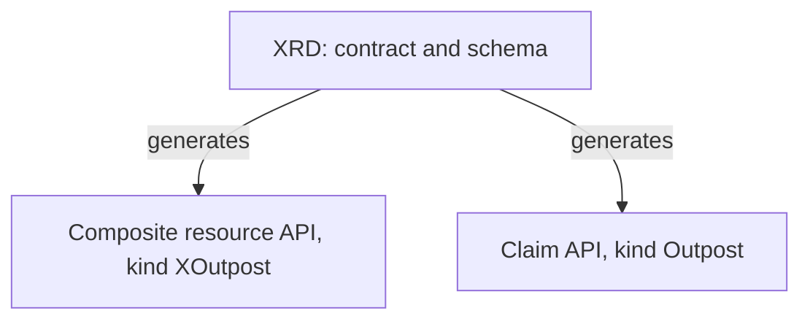

# Claims, Composite Resources And XRDs

A platform team wants developers to ask for an outpost: a namespace with a running scout application. The developers should not need to know how that is built, and they should not be able to ask for something the team does not support. The team could write a wiki page and review every request by hand, or it could add a new API to Kubernetes that accepts exactly one kind of request. This part shows how Crossplane adds that API and what its three objects are.

Crossplane is a set of controllers that run inside a Kubernetes cluster. Its idea is that infrastructure is described by objects, like a Deployment is, and that controllers keep the real thing equal to the description. The platform team uses it to define its own object kinds. A developer then creates one object of such a kind, and Crossplane creates and maintains everything behind it.

## The three objects of an API

The first object is the **composite resource definition**, abbreviated XRD. It is the contract. It names an API group and two kinds, and it holds a schema that says which fields are allowed. The platform team creates it once.



The diagram shows the facts that matter: one XRD produces two custom resource definitions. The first describes the **composite resource**, abbreviated XR, with the kind `XOutpost`. By convention a composite kind starts with the letter X. It is a cluster-scoped object, so it has no namespace. It is the object that Crossplane reconciles and that owns the resources the recipe creates.

The second custom resource definition describes the **claim**, with the kind `Outpost`. A claim is a namespaced object, so a developer can create it in the namespace of their team and Kubernetes access control decides who may do that. The claim has the same schema as the composite resource. It is the only object a developer touches.

## Why two objects and not one

The split solves an ownership problem. A composite resource lives at cluster level, and a namespaced claim cannot own a cluster-level object through the normal owner reference mechanism. So Crossplane stores a reference from the claim to the composite resource in the claim spec, and it stores the claim name and namespace as labels on the composite resource. The claim is the request, and the composite resource is the thing that is reconciled.

This also means a developer needs permission only on `Outpost` in one namespace. The developer does not need permission on the namespace-free composite resource, on the composed resources, or on the provider.

## A note on versions

Crossplane 2 changed how this works. New composite resources can be namespaced and then they need no claim at all. That form has no connection secret support. This module uses the original form, an XRD in `apiextensions.crossplane.io/v1`, because it is the form that still has claims, connection secrets and the claim API that the CNPA exam objectives describe. The XRD in this module has no `scope` field, and the default for this version is the legacy cluster scope with claims.

## What the XRD contains

The XRD has four parts that matter here. `group` and `names` give the group and the composite kind. `claimNames` gives the claim kind, and leaving it out means no claim API exists. `versions` lists the served versions with an OpenAPI schema. `defaultCompositionRef` can name the recipe to use when a claim does not name one. Because the schema is a normal OpenAPI schema, `minimum`, `maximum`, `default` and `enum` all work, and the Kubernetes API server enforces them before Crossplane sees the object.

## Hands-on: create the API

<!-- astrona:playground:renew -->

The playground has Crossplane installed and no XRD. Save this as `xrd-outpost.yaml`:

```yaml
apiVersion: apiextensions.crossplane.io/v1
kind: CompositeResourceDefinition
metadata:
  name: xoutposts.platform.starfleet.example
spec:
  group: platform.starfleet.example
  names:
    kind: XOutpost
    plural: xoutposts
  claimNames:
    kind: Outpost
    plural: outposts
  versions:
    - name: v1alpha1
      served: true
      referenceable: true
      schema:
        openAPIV3Schema:
          type: object
          properties:
            spec:
              type: object
              properties:
                replicas:
                  type: integer
                  minimum: 1
                  maximum: 3
                  default: 1
```

Apply it:

```sh
kubectl apply -f xrd-outpost.yaml
```

Then check the result:

```sh
kubectl wait --for=condition=Established xrd/xoutposts.platform.starfleet.example --timeout=120s
kubectl get crds | grep platform.starfleet.example
```

Two custom resource definitions appear: `xoutposts.platform.starfleet.example` and `outposts.platform.starfleet.example`. Ask Kubernetes to explain a field of the new API:

```sh
kubectl explain outposts.spec.replicas
```

The explanation shows the type and description that came from the schema. Now try a request that breaks the schema. The command validates on the server and creates nothing:

```sh
kubectl -n starfleet create --dry-run=server -f - <<'YAML'
apiVersion: platform.starfleet.example/v1alpha1
kind: Outpost
metadata:
  name: too-big
spec:
  replicas: 9
YAML
```

The API server rejects it and names `spec.replicas`. No Crossplane controller was involved. The schema alone protects the platform from a bad request.

## What exists now and what does not

After the XRD is established, the API exists but nothing can be built from it. A claim created now would be accepted, and it would wait for a Composition that does not exist. The XRD defines what a request looks like. The recipe that turns a request into resources is a separate object, and it comes next.

You now know the three objects and what the XRD generates. What is still open is how the composite resource turns into real resources, which is the job of the Composition.

## Common pitfalls

> [!WARNING]
> A claim and a composite resource are different objects. Editing a composed resource by hand does not change the claim, and Crossplane reverts the change. Change the claim spec instead. Also, an XRD without `claimNames` creates no claim API, so developers would need access to the cluster-level composite resource.
