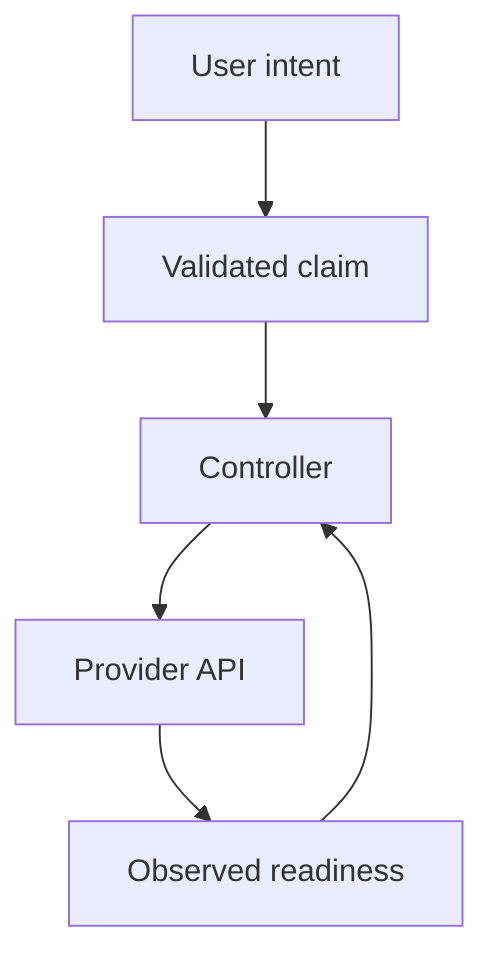

# Infrastructure Claims, Provider Identities And External Lifecycle

A platform can use Kubernetes resources to request and manage infrastructure outside the cluster. A custom claim expresses user intent, while a controller translates it into supported provider operations. Systems such as Crossplane can compose lower-level resources behind a higher-level API. The precise resource model depends on the selected version and implementation, but the responsibilities remain distinct.

The user-facing claim should describe supported needs rather than expose every provider option. A database claim can select a service class, location and retention policy. The platform's composition or controller maps those choices to provider-specific resources. This abstraction reduces repeated work while placing responsibility for the mapping on the platform operator.

Provider identity determines what external actions are possible. The controller may use a cloud role or another approved credential. That authority should fit the intended resources and tenant boundaries. A user should not be able to redirect the controller to an unrelated account or privileged capability through an unconstrained field. Input validation and provider access policy work together.

Consider a development team requesting a database. The API accepts a valid claim. The controller then requests the provider resource and observes its state. The database becomes ready only after the provider and required dependencies satisfy the implementation's conditions. Connection information can be delivered through a protected secret reference. API acceptance alone is not evidence that applications can connect.

Readiness can depend on several resources. Networking, identity and database creation may complete at different times. A composition should expose useful pending and failure conditions instead of requiring users to inspect every low-level provider object. The platform still needs enough internal evidence to locate the blocked dependency when support is required.

Reconciliation continues after creation. The controller can detect selected external changes and maintain assigned properties. Not every field or external action is necessarily managed. Ownership should identify which values the platform controls and which provider behavior is expected to change independently. Two systems imposing conflicting settings can prevent stable operation.

Partial failures require stable identity and observation. A provider may create a resource even when its response is lost. Blindly repeating a creation action can produce duplicates unless the integration's contract prevents them. The controller should use supported identity and recovery behavior to determine what already exists. Declarative input alone does not make every external API idempotent.

Deletion is especially important for persistent infrastructure. Removing a claim can initiate deletion, retain the external resource or require a handoff under policy. Finalizers and provider deletion settings can coordinate parts of that lifecycle. They do not automatically preserve business data or establish a complete backup. The user needs to understand the supported consequence before retiring the claim.

Connection secrets have their own access and rotation requirements. Publishing credentials in status or a public catalog would expose them beyond the intended consumer. A secret reference can separate discovery from sensitive value delivery. Reading metadata about a database should not grant every user its connection authority.

Version changes also affect the platform contract. A new composition can alter capacity, network or retention behavior for existing claims. Adoption policy and compatibility should be deliberate rather than silently switching every consumer to a materially different implementation. The platform should connect the selected implementation version with observable outcome.

Provisioning crosses several separately owned boundaries:

The feedback path shows why acceptance of the claim precedes, rather than proves, usable infrastructure.

## Common pitfalls

> [!WARNING]
> Accepted claims are not ready resources. Constrain provider authority and user references, and account for partial creation. Persistent deletion, backup and credential delivery need explicit policies rather than assumptions attached to the word declarative.
