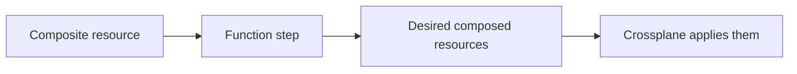

# Compositions And Function Pipelines

The XRD says what a developer may ask for. It does not say what to build. Someone has to decide that an `Outpost` means one namespace, one Deployment and the right number of replicas, and that the name of the namespace follows the name of the claim. In Crossplane that decision is a Composition. This part shows how a Composition is built, what a function pipeline is, and how values travel from a claim into the resources that are created.

A **Composition** is a recipe for one composite kind. It names the composite kind it serves in `compositeTypeRef`, and it lists steps in `pipeline`. Several Compositions can exist for the same kind, for example one for a small environment and one for a large one. The XRD can name a default with `defaultCompositionRef`, and a claim can choose another by name or by label selector. When more than one Composition fits and none is chosen, the claim does not become ready.

## What a pipeline step does

Crossplane no longer renders resources itself. In `Pipeline` mode it calls functions. A function is a small program that runs as a pod in the cluster. Each step in the pipeline names a function and passes it an `input`. Crossplane sends the function the observed composite resource and the observed composed resources, and the function returns the desired composed resources and desired composite state. The steps run in order, and each step sees the desired state that the previous step produced.

This module uses `function-patch-and-transform`, a function that does the work of the older patch-and-transform composition format. Its input has the kind `Resources`. It holds a list of resources, and each entry has a `name`, a `base` and a list of `patches`. The name must be unique in the Composition, because Crossplane uses it to match what exists in the cluster with what the function returns.



## Base and patches

The **base** is a full object with placeholder values. For this module the base is a provider-kubernetes `Object`. The provider kind `Object` wraps any Kubernetes manifest in `spec.forProvider.manifest` and creates it in the cluster. That is why no cloud account is needed: the external resource is an ordinary Kubernetes object, and the provider is the controller that manages it.

A **patch** copies a value from one place to another. The patch type `FromCompositeFieldPath` copies a field of the composite resource into the composed resource. `ToCompositeFieldPath` copies in the other direction, which is how a composed value such as a namespace name reaches the status of the composite resource. A patch can carry `transforms`, for example the string transform `Format`, which builds `outpost-scout` from `scout`. The patch policy `fromFieldPath: Required` makes the patch fail when the source field is missing, and without it a missing field is skipped silently.

The composite resource labels carry the name of the claim. The label `crossplane.io/claim-name` is set by Crossplane on the composite resource when it is created from a claim, so a patch reads the claim name from that label.

## Readiness

A composed resource is ready when its readiness check says so. The default check for each composed resource is the `Ready` condition equal to `True`. For a provider-kubernetes `Object` that condition by default turns true as soon as the object was created. A Deployment would then count as ready before any pod runs. The Object field `readiness.policy` changes that. The value `AllTrue` makes the Object ready only when every condition of the wrapped object is true, and the Deployment condition `Available` is one of them. The composite resource is ready when every composed resource is ready, and the claim copies that.

## Hands-on: write a Composition

<!-- astrona:playground:renew -->

The playground starts clean. First save the XRD as `xrd-outpost.yaml`:

```yaml
apiVersion: apiextensions.crossplane.io/v1
kind: CompositeResourceDefinition
metadata:
  name: xoutposts.platform.starfleet.example
spec:
  group: platform.starfleet.example
  names:
    kind: XOutpost
    plural: xoutposts
  claimNames:
    kind: Outpost
    plural: outposts
  defaultCompositionRef:
    name: outpost-kubernetes
  versions:
    - name: v1alpha1
      served: true
      referenceable: true
      schema:
        openAPIV3Schema:
          type: object
          properties:
            spec:
              type: object
              properties:
                replicas:
                  type: integer
                  default: 1
```

Apply it:

```sh
kubectl apply -f xrd-outpost.yaml
kubectl wait --for=condition=Established xrd/xoutposts.platform.starfleet.example --timeout=120s
```

Save this Composition as `composition-outpost.yaml`. It composes one namespace:

```yaml
apiVersion: apiextensions.crossplane.io/v1
kind: Composition
metadata:
  name: outpost-kubernetes
spec:
  compositeTypeRef:
    apiVersion: platform.starfleet.example/v1alpha1
    kind: XOutpost
  mode: Pipeline
  pipeline:
    - step: compose-outpost
      functionRef:
        name: function-patch-and-transform
      input:
        apiVersion: pt.fn.crossplane.io/v1beta1
        kind: Resources
        resources:
          - name: namespace
            base:
              apiVersion: kubernetes.crossplane.io/v1alpha2
              kind: Object
              spec:
                providerConfigRef:
                  name: local-cluster
                forProvider:
                  manifest:
                    apiVersion: v1
                    kind: Namespace
                    metadata:
                      name: placeholder
            patches:
              - type: FromCompositeFieldPath
                fromFieldPath: metadata.labels[crossplane.io/claim-name]
                toFieldPath: spec.forProvider.manifest.metadata.name
                policy:
                  fromFieldPath: Required
                transforms:
                  - type: string
                    string:
                      type: Format
                      fmt: "outpost-%s"
```

Apply it:

```sh
kubectl apply -f composition-outpost.yaml
```

Then check the result:

```sh
kubectl get composition outpost-kubernetes
kubectl get functions.pkg.crossplane.io
```

The Composition is accepted and the function is healthy. A Composition is only checked when it is used, so a wrong field path or a wrong function name appears later, as a condition on a composite resource and not now.

## What a pipeline can reject

When a patch with `Required` finds no source value, the function returns a fatal result and the composite resource shows it in its `Synced` condition. When the function name does not match an installed function, the composite resource cannot be reconciled and the message names the missing function. Both cases leave existing composed resources unchanged.

You now know how a Composition turns composite fields into composed resources, and how readiness is decided. What is still open is what happens after a claim is created, which comes next.

## Common pitfalls

> [!WARNING]
> Resource names inside a pipeline must stay stable. Renaming a resource in a Composition makes Crossplane see a new resource, and it deletes the old one. Also, the default readiness of a provider-kubernetes Object reports success when the object is created, not when it works. A Deployment needs `readiness.policy: AllTrue` or the claim will report ready too early.
