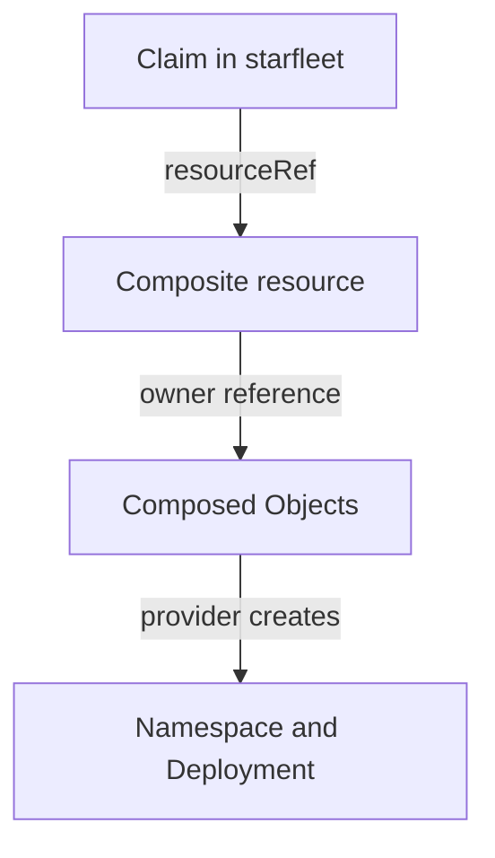

# Following A Claim Through Reconciliation

A developer creates a claim, and a minute later a namespace and a Deployment exist. Nothing in the claim says how. When something fails, the platform team needs to know which object to read and what each field means. This part follows one claim from creation to deletion and names the object, the field and the condition that carry its state at each step.

Crossplane has several controllers that work in turn. They never call each other. Each one watches objects, changes objects, and the next controller sees the change.

## From claim to composed resources

The first controller watches claims. When a claim appears, it selects a Composition, creates a composite resource with a generated name, and writes the reference into the claim in `spec.resourceRef`. The composite resource gets the labels `crossplane.io/claim-name` and `crossplane.io/claim-namespace`, and the claim gets a finalizer so that Crossplane can clean up before the claim disappears.

The second controller watches composite resources. For each one it runs the function pipeline, compares the desired composed resources with the ones that exist, and creates, updates or deletes the difference. Each composed resource gets an owner reference to the composite resource and the label `crossplane.io/composite` with its name. These references are what makes deletion cascade and what lets you list the parts of one claim.

The third controller is the provider controller. It watches the provider `Object` kinds, creates the wrapped Kubernetes object, and reports the result in conditions. A composed Object that fails does not stop the others, because Crossplane creates all composed resources that it can and there is no ordering between them. An Object whose target namespace does not exist yet fails and is retried until the namespace appears.



## Conditions

Every one of these objects reports two conditions. `Synced` says whether the last reconcile succeeded: it is `True` with the reason `ReconcileSuccess` or `False` with `ReconcileError` and a message. `Ready` says whether the resource is working: `True` when every check passed, and `False` while it is being created or after a problem. A claim is `Ready` only when its composite resource is. Read the conditions from the claim downward until you find the first object where `Synced` is `False`. The message there names the cause.

## Status that flows back

Values can also flow back. A patch of type `ToCompositeFieldPath` copies a composed value into the status of the composite resource, and Crossplane copies the composite status to the claim. The XRD schema must declare the status field, or the API server drops it.

## Updates and deletion

A claim update changes the composite resource spec, the pipeline runs again, and patches write the new values into the composed objects. Crossplane then applies the change. A change of `spec.replicas` becomes a change of the Deployment.

Deleting a claim deletes its composite resource. The default policy is `Background`: the composite resource is deleted and Crossplane returns control at once, while the cluster removes the dependents. The other policy, `Foreground`, keeps the claim until the dependents are gone. The setting is `spec.compositeDeletePolicy` on the claim, and `defaultCompositeDeletePolicy` on the XRD sets the default. Composed Objects are removed with their composite resource, and the provider deletes the wrapped objects, because the default deletion policy of an Object is `Delete`.

## Hands-on: follow a claim

<!-- astrona:playground:renew -->

The playground starts clean. Save this as `api.yaml`. It holds the XRD and a Composition with a namespace and a Deployment:

```yaml
apiVersion: apiextensions.crossplane.io/v1
kind: CompositeResourceDefinition
metadata:
  name: xoutposts.platform.starfleet.example
spec:
  group: platform.starfleet.example
  names:
    kind: XOutpost
    plural: xoutposts
  claimNames:
    kind: Outpost
    plural: outposts
  defaultCompositionRef:
    name: outpost-kubernetes
  versions:
    - name: v1alpha1
      served: true
      referenceable: true
      schema:
        openAPIV3Schema:
          type: object
          properties:
            spec:
              type: object
              properties:
                replicas:
                  type: integer
                  default: 1
---
apiVersion: apiextensions.crossplane.io/v1
kind: Composition
metadata:
  name: outpost-kubernetes
spec:
  compositeTypeRef:
    apiVersion: platform.starfleet.example/v1alpha1
    kind: XOutpost
  mode: Pipeline
  pipeline:
    - step: compose-outpost
      functionRef:
        name: function-patch-and-transform
      input:
        apiVersion: pt.fn.crossplane.io/v1beta1
        kind: Resources
        resources:
          - name: namespace
            base:
              apiVersion: kubernetes.crossplane.io/v1alpha2
              kind: Object
              spec:
                providerConfigRef:
                  name: local-cluster
                forProvider:
                  manifest:
                    apiVersion: v1
                    kind: Namespace
                    metadata:
                      name: placeholder
            patches:
              - type: FromCompositeFieldPath
                fromFieldPath: metadata.labels[crossplane.io/claim-name]
                toFieldPath: spec.forProvider.manifest.metadata.name
                policy:
                  fromFieldPath: Required
                transforms:
                  - type: string
                    string:
                      type: Format
                      fmt: "outpost-%s"
          - name: deployment
            base:
              apiVersion: kubernetes.crossplane.io/v1alpha2
              kind: Object
              spec:
                providerConfigRef:
                  name: local-cluster
                readiness:
                  policy: AllTrue
                forProvider:
                  manifest:
                    apiVersion: apps/v1
                    kind: Deployment
                    metadata:
                      name: scout
                      namespace: placeholder
                    spec:
                      replicas: 1
                      selector:
                        matchLabels:
                          app: scout
                      template:
                        metadata:
                          labels:
                            app: scout
                        spec:
                          containers:
                            - name: scout
                              image: ghcr.io/stefanprodan/podinfo:6.15.0
                              ports:
                                - containerPort: 9898
            patches:
              - type: FromCompositeFieldPath
                fromFieldPath: metadata.labels[crossplane.io/claim-name]
                toFieldPath: spec.forProvider.manifest.metadata.namespace
                policy:
                  fromFieldPath: Required
                transforms:
                  - type: string
                    string:
                      type: Format
                      fmt: "outpost-%s"
              - type: FromCompositeFieldPath
                fromFieldPath: spec.replicas
                toFieldPath: spec.forProvider.manifest.spec.replicas
```

Apply it:

```sh
kubectl apply -f api.yaml
kubectl wait --for=condition=Established xrd/xoutposts.platform.starfleet.example --timeout=120s
```

Save this as `claim-scout.yaml`:

```yaml
apiVersion: platform.starfleet.example/v1alpha1
kind: Outpost
metadata:
  name: scout
  namespace: starfleet
spec:
  replicas: 2
```

Apply it:

```sh
kubectl apply -f claim-scout.yaml
```

Then check the result by walking down the chain:

```sh
kubectl -n starfleet get outposts.platform.starfleet.example scout
kubectl get xoutposts.platform.starfleet.example
kubectl get objects.kubernetes.crossplane.io -l crossplane.io/composite
kubectl -n outpost-scout get deployment scout
```

Both objects first show `READY` as `False` and later `True`, because the image must be pulled. Now delete the claim and check that everything built for it is removed:

```sh
kubectl -n starfleet delete outposts.platform.starfleet.example scout
kubectl get namespace outpost-scout
```

You now know which object carries which state, and how a claim and its resources are linked. What is left is to build the whole chain yourself.

## Common pitfalls

> [!WARNING]
> Reading only the claim hides the cause. The claim reports that something is wrong, and the failing object is further down. Also, deleting a claim with the default `Background` policy returns at once, so the namespace and Deployment can exist for a short time after the command finishes. Wait for them before you conclude that deletion did not work.
