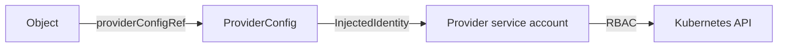

# Providers, ProviderConfigs And Identity

A claim for an outpost is accepted, the composite resource exists, and the composed objects are created. One of them stays unhealthy with a message that says a Deployment cannot be created. Nothing is wrong with the claim or the Composition. The component that creates the real resource is not allowed to. This part explains what that component is, which identity it uses, and where the permission comes from.

Crossplane itself does not know how to create a database, a bucket or a Deployment. It only knows how to run pipelines and compare desired and observed state. The knowledge about a particular system lives in a **provider**, a package that adds custom resource definitions and a controller. For this module the provider is provider-kubernetes. It adds the kind `Object`, which wraps a Kubernetes manifest, and the kind `ProviderConfig`.

## What installing a provider does

A `Provider` object names a package image and a version. Crossplane pulls the package, installs its custom resource definitions, and starts the provider controller as a pod in the namespace `crossplane-system`. The version is part of the contract: a provider upgrade can change the fields of its kinds. The pod runs with a Kubernetes service account. Crossplane can set that name with a `DeploymentRuntimeConfig` that the Provider references, and the playground uses the name `provider-kubernetes` so the identity is easy to find.

A Provider is `Installed` when the package is unpacked and `Healthy` when the controller pod is running. If the image cannot be pulled, neither condition becomes true.

## What a ProviderConfig does

A **ProviderConfig** tells the provider how to reach the target system and with which credentials. Every composed resource names one in `spec.providerConfigRef`. The ProviderConfig in this module is named `local-cluster` and uses the credentials source `InjectedIdentity`. That source means the provider uses the token of its own service account to call the Kubernetes API of the cluster it runs in. Other sources read a kubeconfig from a Secret, which is how the same provider manages another cluster.

Two consequences follow. A composed resource that names a ProviderConfig that does not exist cannot be reconciled, and its `Synced` condition is `False` with a message that names the missing config. And one provider can serve many targets, because each composed resource chooses its ProviderConfig. A platform team uses this to send development and production claims to different clusters or accounts with different credentials.



## What the objects look like

The ProviderConfig of this module is small. Its whole content is the name of the credentials source:

```yaml
apiVersion: kubernetes.crossplane.io/v1alpha1
kind: ProviderConfig
metadata:
  name: local-cluster
spec:
  credentials:
    source: InjectedIdentity
```

A composed resource points at it by name, and only by name. A Composition can therefore be written once and used with any target, as long as a ProviderConfig of that name exists where the claim is reconciled.

The provider package has a version tag, and the tag decides which fields exist. The playground pins provider-kubernetes to v1.4.1 and function-patch-and-transform to v0.11.2. Pinned versions make an environment repeatable: the same manifests behave the same way on the next day. A tag such as `latest` can change under a running platform and is avoided for that reason.

## Identity and permission are two things

The ProviderConfig chooses the identity. It does not grant anything. What the identity may do is decided by the normal Kubernetes role-based access control of the target. With injected identity the target is the same cluster, so the service account needs a ClusterRole that covers each kind of object that a Composition wraps. The least privilege rule applies: grant the verbs on the kinds the Compositions use, and nothing broader.

A failure of permission shows up in the composed Object as `Synced` equal to `False`, the reason `ReconcileError`, and a message from the Kubernetes API that contains the word `forbidden` and the name of the service account. Crossplane keeps retrying with a growing delay, and the Object becomes synced shortly after the permission is added.

## Hands-on: read the identity

<!-- astrona:playground:renew -->

The playground has a working claim API and two claims, `scout` and `probe`. Start with the provider and its configuration:

```sh
kubectl get providers.pkg.crossplane.io
kubectl get providerconfigs.kubernetes.crossplane.io local-cluster -o jsonpath='{.spec.credentials.source}{"\n"}'
```

The provider is `Healthy` and the source is `InjectedIdentity`. Find the pod and its service account:

```sh
kubectl -n crossplane-system get pods
kubectl -n crossplane-system get deployments -o jsonpath='{range .items[*]}{.metadata.name}{"\t"}{.spec.template.spec.serviceAccountName}{"\n"}{end}'
```

One deployment runs with the service account `provider-kubernetes`. Ask the cluster what that account may do:

```sh
kubectl auth can-i create namespaces --as=system:serviceaccount:crossplane-system:provider-kubernetes
kubectl auth can-i create deployments.apps --as=system:serviceaccount:crossplane-system:provider-kubernetes
```

The first answer is `yes` and the second is `no`. That difference is the whole problem of the two claims. Find the evidence in the composed Objects:

```sh
kubectl get objects.kubernetes.crossplane.io
kubectl get objects.kubernetes.crossplane.io -o jsonpath='{range .items[*]}{.metadata.name}{"\t"}{.status.conditions[?(@.type=="Synced")].status}{"\t"}{.status.conditions[?(@.type=="Synced")].message}{"\n"}{end}'
```

The Objects for the namespace, Service and record are synced. The Objects for the Deployments are not, and their message contains `forbidden`. The claims are not ready because one of their four composed resources is not.

## Where the permission can be fixed

The permission is added in Kubernetes, not in Crossplane. A ClusterRole for the kind and a ClusterRoleBinding to the provider service account is the full fix. Changing the Composition, the claim or the ProviderConfig does not help. A common shortcut is to bind `cluster-admin` to the provider. It works, and it also lets every Composition and every claim author create any object in the cluster through the provider, so it is only acceptable in a throw-away environment.

You now know that a provider is a package with a controller, that a ProviderConfig chooses an identity, and that RBAC decides what the identity may do. What is still open is how a finished resource gives information back and how to read a failure that affects only part of a claim.

## Common pitfalls

> [!WARNING]
> Binding `cluster-admin` to the provider service account makes every error of permission disappear, and it also removes the only boundary between a claim author and the whole cluster. Also, a missing ProviderConfig and a missing permission look similar from the claim, so read the message of the failing Object before you change anything.
