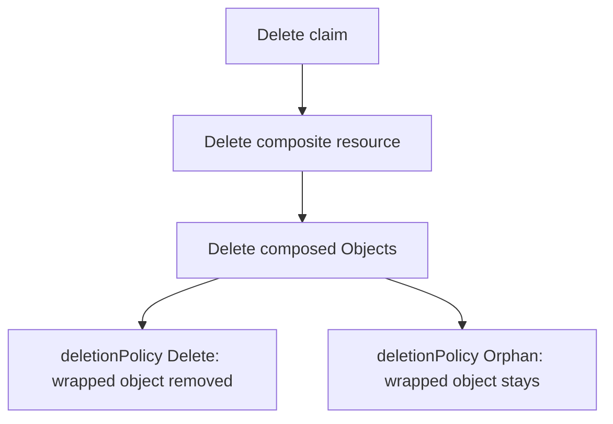

# Management Policies And Deletion

A team deletes the claim of an outpost that is no longer needed. The namespace and the Deployment should go. The record of the outpost should stay, because an auditor may ask about it next year. Crossplane deletes everything it manages by default, so the platform team must say which resources are different. This part covers the settings that control what a managed resource may do, and what stays when a claim is deleted.

## Management policies

Every managed resource has `spec.managementPolicies`, a list of actions that the provider may take. The actions are `Observe`, `Create`, `Update`, `Delete` and `LateInitialize`. The value `*` stands for all of them, and it is the default. Removing an action removes that power. A resource with only `Observe` is read and never changed or created, which is how an existing object is brought under observation without letting Crossplane own it. A resource with `Create`, `Observe` and `Update` but not `Delete` is never deleted by the provider, even when its Object is deleted. Management policies are a beta feature that is on by default in this version.

## The deletion policy

The older setting `spec.deletionPolicy` answers one question: when the Crossplane object is deleted, is the real resource deleted as well? The value `Delete` is the default, and the real resource is removed. The value `Orphan` removes only the Crossplane object and leaves the real resource. For provider-kubernetes the real resource is the wrapped Kubernetes object, so an orphaned Object leaves the namespace, ConfigMap or Deployment in place with nothing managing it.

The Object kind adds a second setting, `spec.forProvider.deletionPropagationPolicy`. It controls how the wrapped object is deleted when it is deleted: `Background`, the default, returns at once and the cluster deletes the dependents later, and `Foreground` and `Orphan` follow the Kubernetes meaning of the same names. It does not decide whether the wrapped object is deleted at all. That is the job of the deletion policy.

## What a claim deletion deletes

Deleting a claim deletes its composite resource, which deletes every composed resource through owner references. Each composed Object then follows its own deletion policy. So a Composition can keep the record of a claim by setting `deletionPolicy: Orphan` on that one resource in its `base`. The claim, the composite resource and the Object are gone, and the ConfigMap stays.

The claim has its own setting, `spec.compositeDeletePolicy`. `Background` deletes the claim at once and lets the composite resource finish later. `Foreground` keeps the claim until the composite resource is gone, so a claim that still exists tells the developer the removal has not finished. The XRD field `defaultCompositeDeletePolicy` sets the default for all claims.



## What the settings look like

Both settings are fields of the Object. This base keeps the wrapped ConfigMap when the Object is deleted:

```yaml
apiVersion: kubernetes.crossplane.io/v1alpha2
kind: Object
spec:
  deletionPolicy: Orphan
  providerConfigRef:
    name: local-cluster
  forProvider:
    manifest:
      apiVersion: v1
      kind: ConfigMap
```

An Object that only watches an existing object would use management policies instead. It is read, and never created, changed or deleted:

```yaml
spec:
  managementPolicies: ["Observe"]
```

The two settings overlap. When `managementPolicies` has no `Delete`, the provider never deletes the real resource, whatever `deletionPolicy` says. Keep to one of the two in a Composition, so the next reader does not have to work out which one wins.

## Changes reach existing resources

A change to the Composition does not change the base of resources that already exist in a way the operator sees at once. Crossplane creates a new revision of the Composition, and composite resources with the update policy `Automatic`, which is the default, move to the new revision on their next reconcile. The composed Objects are then updated. Only after that does an Object carry a new `deletionPolicy`. Delete a claim before its Object has the new value, and the old behavior applies.

## Pausing

The annotation `crossplane.io/paused` with the value `"true"` stops reconciliation of an object. The object keeps its state and its `Synced` condition shows the reason `ReconcilePaused`. Pausing is used to stop Crossplane while an operator changes something by hand. It does not change what a deletion does.

## Hands-on: see what a deletion keeps

<!-- astrona:playground:renew -->

Read the deletion policy of each composed Object of the claim `probe`:

```sh
kubectl get objects.kubernetes.crossplane.io -l crossplane.io/claim-name=probe -o jsonpath='{range .items[*]}{.metadata.name}{"\t"}{.spec.deletionPolicy}{"\n"}{end}'
```

All four show `Delete`. Pause the Objects of the claim and read their conditions:

```sh
kubectl annotate objects.kubernetes.crossplane.io -l crossplane.io/claim-name=probe crossplane.io/paused=true
kubectl get objects.kubernetes.crossplane.io -l crossplane.io/claim-name=probe -o jsonpath='{range .items[*]}{.metadata.name}{"\t"}{.status.conditions[?(@.type=="Synced")].reason}{"\n"}{end}'
```

The reason is `ReconcilePaused` for the paused Objects. Remove the annotation again:

```sh
kubectl annotate objects.kubernetes.crossplane.io -l crossplane.io/claim-name=probe crossplane.io/paused-
```

Now delete the claim and see the default behavior:

```sh
kubectl -n starfleet delete outposts.platform.starfleet.example probe
kubectl get namespace outpost-probe
kubectl -n starfleet-records get configmap
```

The namespace `outpost-probe` goes away, and so does the ConfigMap `record-probe`, because every Object used the deletion policy `Delete`. To keep the ConfigMap, the Composition must set `deletionPolicy: Orphan` on the resource named `record`, and the change must reach an Object before its claim is deleted.

You now know which settings decide what is created, changed and deleted, and in which order a deletion happens. The lab asks you to use them.

## Common pitfalls

> [!WARNING]
> Setting `deletionPolicy: Orphan` is not backup. The orphaned object stays in the cluster with nothing managing it, and nothing updates or removes it later. Also, an Orphan setting that is added to a Composition applies only to Objects that were updated after the change, so confirm the field on the Object before you delete the claim.
