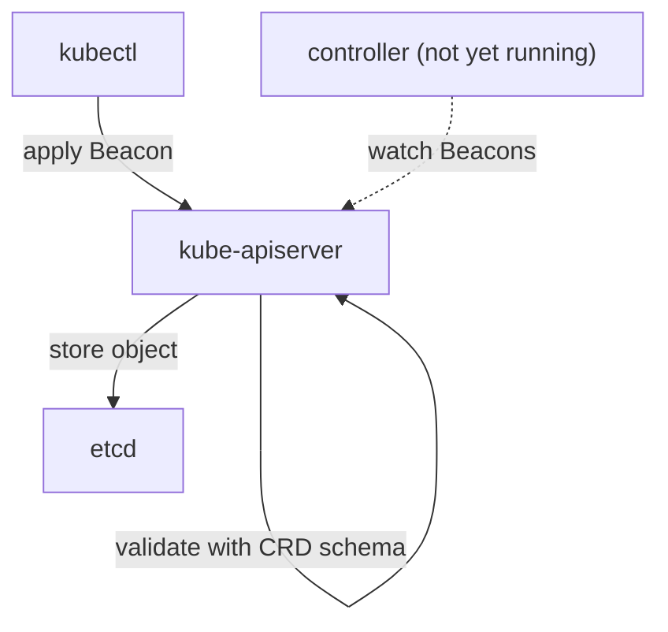

# A CRD Without A Controller

The platform team wants developers to ask for a "beacon" by writing one small YAML file, instead of creating ConfigMaps by hand. Kubernetes has no `Beacon` type, so the team must add one. This part adds the type and then shows what it does and does not do. The result is the most important fact about operators: the API server only stores the request.

## What a CRD registers

A CustomResourceDefinition (CRD) is a Kubernetes object that tells the API server about a new resource type. The API server (`kube-apiserver`) reads the CRD and starts serving a new REST path for the type, for example `/apis/ops.starfleet.example/v1/namespaces/starfleet/beacons`. After that, `kubectl get beacons` works like `kubectl get pods`.

The CRD also carries an OpenAPI v3 schema. The API server validates every create and update against the schema before it writes the object to etcd, the key-value store behind the API server. It can also fill in default values. This validation is the only logic that the CRD provides. It checks the shape of the data. It does not act on the data.

A CRD has a group, a kind, a scope and one or more versions. The group (`ops.starfleet.example`) is the API group part of `apiVersion`. The kind (`Beacon`) is the name of the type. The scope is `Namespaced` or `Cluster`. Each version has its own schema, and exactly one version is the storage version, the one the API server writes to etcd.

## Try it: register the Beacon type

A `Beacon` carries a message and a channel. The channel may be `routine` or `alert` and defaults to `routine`. The status holds three fields that only a controller will write. The `status: {}` entry under `subresources` turns on the status subresource, a separate endpoint for status, so that a change to `spec` and a change to `status` are different requests with different permissions.

Save this as `crd-beacon.yaml`:

<!-- astrona:playground:renew -->

```yaml
apiVersion: apiextensions.k8s.io/v1
kind: CustomResourceDefinition
metadata:
  name: beacons.ops.starfleet.example
spec:
  group: ops.starfleet.example
  scope: Namespaced
  names:
    kind: Beacon
    listKind: BeaconList
    plural: beacons
    singular: beacon
    shortNames:
      - bcn
  versions:
    - name: v1
      served: true
      storage: true
      subresources:
        status: {}
      additionalPrinterColumns:
        - name: Channel
          type: string
          jsonPath: .spec.channel
        - name: Phase
          type: string
          jsonPath: .status.phase
        - name: Age
          type: date
          jsonPath: .metadata.creationTimestamp
      schema:
        openAPIV3Schema:
          type: object
          properties:
            spec:
              type: object
              required: ["message"]
              properties:
                message:
                  type: string
                  minLength: 1
                  maxLength: 200
                channel:
                  type: string
                  enum: ["routine", "alert"]
                  default: "routine"
            status:
              type: object
              properties:
                phase:
                  type: string
                observedGeneration:
                  type: integer
                  format: int64
                configMapName:
                  type: string
```

Apply it:

```sh
kubectl apply -f crd-beacon.yaml
```

Then check the result:

```sh
kubectl wait --for=condition=Established crd/beacons.ops.starfleet.example --timeout=60s
kubectl api-resources --api-group=ops.starfleet.example
```

The `Established` condition means the API server now serves the type. The second command lists one resource, `beacons`, with the short name `bcn` and the kind `Beacon`. The `additionalPrinterColumns` entries decide which columns `kubectl get` shows: the channel, the phase and the age.

## Create a Beacon and see what happens

Save this as `beacon-scout.yaml`:

```yaml
apiVersion: ops.starfleet.example/v1
kind: Beacon
metadata:
  name: scout
  namespace: starfleet
spec:
  message: "scout online"
```

Apply it:

```sh
kubectl apply -f beacon-scout.yaml
```

Then check the result:

```sh
kubectl -n starfleet get beacon scout -o yaml
kubectl -n starfleet get beacons,configmaps
```

The YAML shows `channel: routine` in `spec`, although you did not write it. The API server filled in the default from the schema. The YAML has no `status` section. The list shows the `Beacon` with an empty `PHASE` column and no ConfigMap that belongs to it, except the `kube-root-ca.crt` ConfigMap that Kubernetes creates in every namespace.

Nothing will change if you wait. No process in the cluster knows what a `Beacon` is. The API server stored the object and returned. That is all a CRD does.

## Validation is the schema, and nothing more

The schema rejects a request before it reaches etcd. Save this as `beacon-invalid.yaml`:

```yaml
apiVersion: ops.starfleet.example/v1
kind: Beacon
metadata:
  name: broken
  namespace: starfleet
spec:
  message: ""
  channel: loud
```

Apply it:

```sh
kubectl apply -f beacon-invalid.yaml
```

The command fails. The error comes from the API server and names the fields `spec.message` and `spec.channel`: the empty string is shorter than `minLength: 1`, and `loud` is not one of the values in `enum`. No `Beacon` named `broken` exists afterwards. You can check with `kubectl -n starfleet get beacons`.

The schema cannot express rules that depend on other objects. It cannot say "the channel must exist in another system" or "the message must be unique across namespaces". Rules like that need a controller or an admission webhook, which is code that the API server calls before it stores an object.

## Where the work happens

The next diagram shows who does what when you apply the `Beacon`.



The API server validates and stores the object. The dotted arrow is the missing piece: a controller that watches `Beacon` objects and acts on them. The next part builds it.

The split between API and implementation is the same for every operator. The CRD is the contract that users read and write. The controller is one possible implementation of that contract. Two different controllers could serve the same CRD, and a CRD without any controller is a valid but useless cluster state. For this reason an installation of a real operator always has two parts: the CRDs and the Deployment that runs the controller.

You now know that the API server stores a `Beacon` and validates its shape, and that nothing reacts to it. The open question is how a program can watch the type and make the cluster match the request. That is the job of the reconcile loop.

## Common pitfalls

> [!WARNING]
> - Do not expect a CRD to create anything. A `Beacon` with an empty `PHASE` and no child object is the normal state when no controller runs. Check for a running controller before you debug the resource.
> - A schema validates shape, not meaning. `minLength` and `enum` stop bad input. They do not check that the message makes sense or that a dependency exists.
> - A default in the schema fills in a missing field when the API server handles the object. It is not a rule: a user can still write another valid value, and a field with a default is not required.
> - Without the `status` subresource, `status` is just another part of the object, and anyone who can update the object can write it. Turn the subresource on for every type that reports status.
