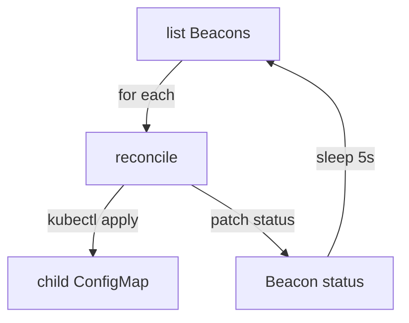

# A Reconcile Loop In A Deployment

The `Beacon` type exists, and the API server stores `Beacon` objects without acting on them. Now the platform team needs the controller: a program that watches `Beacon` objects and makes the cluster match them. In this part you run that program as a Deployment, you give it a service account with only the permissions it needs, and you make it create a ConfigMap for every `Beacon` and report status.

## What a controller does

A controller is a loop that compares the desired state with the actual state and acts on the difference. For a `Beacon`, the desired state is in `spec`: a message and a channel. The actual state is the cluster: does the ConfigMap `beacon-scout` exist, and does it hold the same message? The step that closes the difference is called **reconciling**, and the function that does it is the **reconcile function**.

A production controller usually uses a client library with a watch: the API server pushes an event whenever a `Beacon` changes. The example operator here uses a simpler way that has the same logic. It lists the `Beacon` resources every five seconds and reconciles each one. This is called level-based: the function looks at the current state and does not depend on which event came first. A missed event is harmless, because the next loop looks at the state again.

The reconcile function has one rule that matters more than the others: it must be **idempotent**. Idempotent means that running it twice gives the same result as running it once. A controller restarts, loses events and sees the same object many times. If each run created another ConfigMap, the cluster would fill with copies.

## The operator is a Deployment

The controller is an ordinary workload. It runs as a pod in a Deployment, so the Deployment controller restarts it if it crashes. It uses the `alpine/k8s:1.35.8` image, which contains `bash`, `kubectl` and `jq`. The script is not baked into an image. It lives in a ConfigMap and the pod mounts it as a file, so you can read and change the logic with `kubectl`.

Inside a pod, `kubectl` finds the API server address and the pod's service account token by itself. Every request the script makes is therefore authenticated as the service account of the pod, and the API server checks it against RBAC (role-based access control), the rules that say which identity may do which verb on which resource.

## Try it: grant the access first

Least privilege means the operator gets exactly the access its script uses. The script lists and reads `Beacon` resources in `starfleet`, and it creates and updates ConfigMaps in `starfleet`. Nothing else. A Role limits the permission to one namespace, and a RoleBinding gives the Role to the service account.

Save this as `rbac-beacon-operator.yaml`:

<!-- astrona:playground:renew -->

```yaml
apiVersion: v1
kind: ServiceAccount
metadata:
  name: beacon-operator
  namespace: beacon-system
---
apiVersion: rbac.authorization.k8s.io/v1
kind: Role
metadata:
  name: beacon-operator
  namespace: starfleet
rules:
  - apiGroups: ["ops.starfleet.example"]
    resources: ["beacons"]
    verbs: ["get", "list", "watch"]
  - apiGroups: [""]
    resources: ["configmaps"]
    verbs: ["get", "list", "create", "update", "patch"]
---
apiVersion: rbac.authorization.k8s.io/v1
kind: RoleBinding
metadata:
  name: beacon-operator
  namespace: starfleet
subjects:
  - kind: ServiceAccount
    name: beacon-operator
    namespace: beacon-system
roleRef:
  apiGroup: rbac.authorization.k8s.io
  kind: Role
  name: beacon-operator
```

Apply it:

```sh
kubectl apply -f rbac-beacon-operator.yaml
```

Then check the result:

```sh
kubectl auth can-i list beacons.ops.starfleet.example -n starfleet --as=system:serviceaccount:beacon-system:beacon-operator
kubectl auth can-i get secrets -n starfleet --as=system:serviceaccount:beacon-system:beacon-operator
```

The first command prints `yes` and the second prints `no`. The `kubectl auth can-i --as` command asks the API server what an identity may do, so you can test permissions without running the operator.

The Role does not allow any change to a `Beacon`. The script will write `status` in a moment, which needs a second rule. The next steps show what happens when the permission is missing.

## The reconcile script

The script has three functions. `ensure_child` builds the desired ConfigMap with `jq` and applies it with `kubectl apply`. Applying the same manifest again changes nothing, so the function is idempotent. `update_status` writes status through the status subresource, and only when the stored status differs. `reconcile` reads one `Beacon` and calls the two functions.

Save this as `configmap-beacon-operator-script.yaml`:

```yaml
apiVersion: v1
kind: ConfigMap
metadata:
  name: beacon-operator-script
  namespace: beacon-system
data:
  reconcile.sh: |
    #!/usr/bin/env bash
    # Reconcile loop for Beacon resources: child ConfigMap and status.
    set -u
    WATCH_NAMESPACE="${WATCH_NAMESPACE:-starfleet}"
    INTERVAL="${INTERVAL:-5}"
    
    log() { echo "$(date -u +%Y-%m-%dT%H:%M:%SZ) $*"; }
    
    # ensure_child builds the desired ConfigMap and applies it. Applying the same
    # manifest again changes nothing, so the function is safe to repeat.
    ensure_child() {
      local name="$1" message="$2" channel="$3"
      jq -n --arg ns "$WATCH_NAMESPACE" --arg name "$name" --arg message "$message" --arg channel "$channel" '{
        apiVersion: "v1",
        kind: "ConfigMap",
        metadata: {
          name: ("beacon-" + $name),
          namespace: $ns,
          labels: {"app.kubernetes.io/managed-by": "beacon-operator"}
        },
        data: {message: $message, channel: $channel}
      }' | kubectl apply -f - >/dev/null
    }
    
    # update_status writes status only when it differs from what is stored.
    update_status() {
      local name="$1" generation="$2" observed="$3" phase="$4"
      if [ "$observed" = "$generation" ] && [ "$phase" = "Ready" ]; then
        return 0
      fi
      kubectl -n "$WATCH_NAMESPACE" patch beacon "$name" --subresource=status --type=merge \
        -p "$(jq -nc --argjson generation "$generation" --arg configmap "beacon-$name" \
          '{status: {phase: "Ready", observedGeneration: $generation, configMapName: $configmap}}')" >/dev/null
    }
    
    reconcile() {
      local name="$1" json message channel generation observed phase
      json="$(kubectl -n "$WATCH_NAMESPACE" get beacon "$name" -o json 2>/dev/null)" || return 0
      message="$(jq -r '.spec.message' <<<"$json")"
      channel="$(jq -r '.spec.channel // "routine"' <<<"$json")"
      generation="$(jq -r '.metadata.generation' <<<"$json")"
      observed="$(jq -r '.status.observedGeneration // 0' <<<"$json")"
      phase="$(jq -r '.status.phase // ""' <<<"$json")"
      ensure_child "$name" "$message" "$channel" || { log "error: cannot ensure child for $name"; return 1; }
      update_status "$name" "$generation" "$observed" "$phase" || log "error: cannot update status for $name"
    }
    
    log "beacon-operator starting, namespace=$WATCH_NAMESPACE interval=${INTERVAL}s"
    while true; do
      for name in $(kubectl -n "$WATCH_NAMESPACE" get beacons -o jsonpath='{.items[*].metadata.name}' 2>/dev/null); do
        reconcile "$name"
      done
      sleep "$INTERVAL"
    done
```

Apply it:

```sh
kubectl apply -f configmap-beacon-operator-script.yaml
```

The `update_status` function compares `status.observedGeneration` with `metadata.generation`. The API server increases `metadata.generation` each time the `spec` changes. The operator copies the number into `status.observedGeneration` after it has handled that version of the `spec`. A reader who sees both numbers equal knows that the status describes the current request, and not an older one.

## Run the operator

Save this as `deployment-beacon-operator.yaml`:

```yaml
apiVersion: apps/v1
kind: Deployment
metadata:
  name: beacon-operator
  namespace: beacon-system
spec:
  replicas: 1
  selector:
    matchLabels:
      app: beacon-operator
  template:
    metadata:
      labels:
        app: beacon-operator
    spec:
      serviceAccountName: beacon-operator
      containers:
        - name: operator
          image: alpine/k8s:1.35.8
          command: ["bash", "/scripts/reconcile.sh"]
          env:
            - name: HOME
              value: /tmp
            - name: WATCH_NAMESPACE
              value: starfleet
            - name: INTERVAL
              value: "5"
          securityContext:
            runAsNonRoot: true
            runAsUser: 65532
            readOnlyRootFilesystem: true
            allowPrivilegeEscalation: false
            capabilities:
              drop: ["ALL"]
          volumeMounts:
            - name: script
              mountPath: /scripts
            - name: tmp
              mountPath: /tmp
      volumes:
        - name: script
          configMap:
            name: beacon-operator-script
            defaultMode: 0555
        - name: tmp
          emptyDir: {}
```

Apply it:

```sh
kubectl apply -f deployment-beacon-operator.yaml
```

Then check the result:

```sh
kubectl -n beacon-system rollout status deployment/beacon-operator
kubectl -n beacon-system logs deployment/beacon-operator
kubectl -n starfleet get beacons,configmaps
```

The log starts with the line `beacon-operator starting, namespace=starfleet interval=5s`. The `Beacon` named `scout` now has a ConfigMap `beacon-scout`. The `PHASE` column of the `Beacon` is still empty. The script tried to patch the status, and the API server answered `Forbidden`, because the Role has no rule for `beacons/status`. The script prints that as the log line `error: cannot update status for scout`, and the child ConfigMap exists anyway: a failed step does not stop the other steps.

## Fix the missing permission

The status subresource is a separate resource in RBAC, named `beacons/status`. Save this as `rbac-beacon-operator.yaml`, replacing the earlier file, with one rule added:

```yaml
apiVersion: rbac.authorization.k8s.io/v1
kind: Role
metadata:
  name: beacon-operator
  namespace: starfleet
rules:
  - apiGroups: ["ops.starfleet.example"]
    resources: ["beacons"]
    verbs: ["get", "list", "watch"]
  - apiGroups: ["ops.starfleet.example"]
    resources: ["beacons/status"]
    verbs: ["get", "patch"]
  - apiGroups: [""]
    resources: ["configmaps"]
    verbs: ["get", "list", "create", "update", "patch"]
```

Apply it:

```sh
kubectl apply -f rbac-beacon-operator.yaml
```

Then check the result. RBAC changes take effect at once, so the next loop works without a restart:

```sh
kubectl -n starfleet get beacon scout
kubectl -n starfleet get beacon scout -o jsonpath='{.status}'
```

After at most one loop the `PHASE` column shows `Ready`, and the status holds `phase`, `observedGeneration` and `configMapName`. The ServiceAccount and the RoleBinding stay as they were, because the apply changes only the Role.

## Idempotency and self-healing

Two tests show the loop is level-based. First, change the `spec`. Patch the message:

```sh
kubectl -n starfleet patch beacon scout --type=merge -p '{"spec":{"message":"scout changed"}}'
kubectl -n starfleet get configmap beacon-scout -o jsonpath='{.data.message}'
```

After a few seconds the ConfigMap holds `scout changed`, and `observedGeneration` equals `metadata.generation` again. The operator found the difference and applied it.

Second, damage the child by hand and delete the operator pod:

```sh
kubectl -n starfleet delete configmap beacon-scout
kubectl -n beacon-system delete pod -l app=beacon-operator
kubectl -n starfleet get configmaps
```

The Deployment starts a new pod, and the ConfigMap `beacon-scout` returns within a few loops. No event told the operator about the deletion. It simply compared the desired state with the cluster. Run the loop any number of times and the result is one ConfigMap per `Beacon`.



The diagram shows one loop: list, reconcile each `Beacon` by applying the child and patching the status, then wait.

You now have a working operator: a CRD for the API, a Deployment for the controller, and RBAC that matches what the script does. The open question is deletion. If you delete the `Beacon`, what happens to the ConfigMap, and what about something the operator created outside the namespace?

## Common pitfalls

> [!WARNING]
> - A controller needs RBAC for every verb it uses. A missing rule does not crash the loop in this script. It shows up as `Forbidden` in the log and as a status that never appears. Read the log first.
> - `beacons` and `beacons/status` are two different resources in a Role. A rule for one does not cover the other.
> - Do not create objects with `kubectl create` in a loop. The second run fails with `AlreadyExists`. Use `kubectl apply` or test for the object first.
> - The pod reads the script when it starts. A changed ConfigMap does not change a running script, so restart the Deployment after an edit.
> - Do not write status on every loop. A status write that changes a timestamp each time makes a new object version every five seconds.
