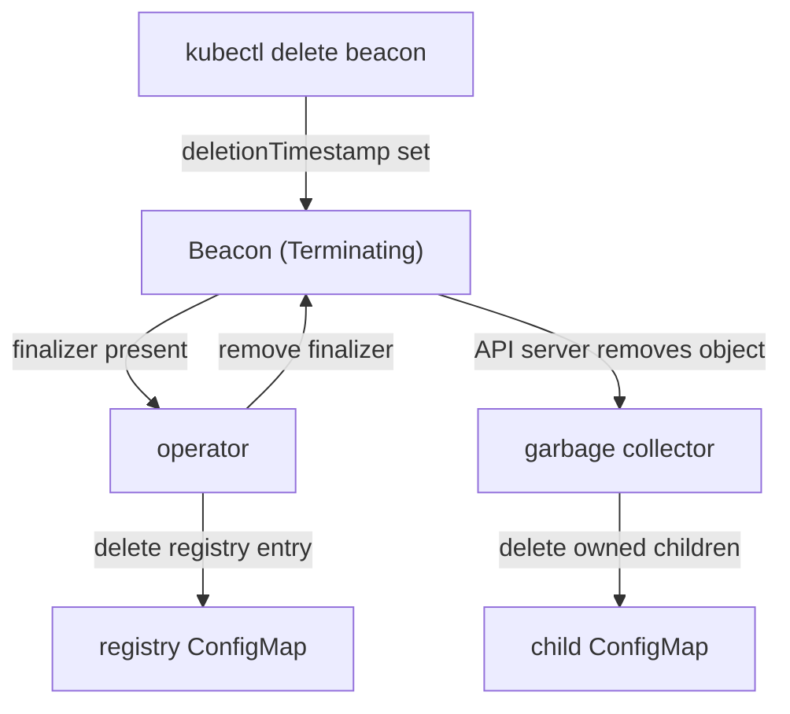

# Finalizers And Owner References

Creating objects is half of an operator's job. The other half is removing them when the user deletes the request. If the operator leaves its ConfigMaps and registry entries behind, every deleted `Beacon` leaves garbage. Kubernetes gives two tools for this, and they solve different problems. This part adds both to the operator and then shows what happens when the operator is not running.

## Two kinds of cleanup

An **owner reference** is a field in `metadata.ownerReferences` of a child object. It names the owner by `apiVersion`, `kind`, `name` and `uid`. When the owner is deleted, the garbage collector, a controller inside `kube-controller-manager`, deletes the child too. The operator does no work for this. The owner reference has one limit: a namespaced child may have an owner only in the same namespace.

A **finalizer** is a string in `metadata.finalizers` of an object. When a user deletes an object that has a finalizer, the API server does not remove it. It sets `metadata.deletionTimestamp` and leaves the object in place. The object stays until every finalizer is removed from the list. A controller uses this window to run cleanup that Kubernetes cannot do for it, and then removes its own finalizer.

The `Beacon` example needs both. The child ConfigMap `beacon-scout` is in the same namespace as the `Beacon`, so an owner reference is enough. The registry entry is a ConfigMap in `beacon-registry`, a different namespace. It cannot have the `Beacon` as owner. It needs a finalizer, so the operator can delete the entry before the `Beacon` disappears.

## Try it: widen the access by exactly what the new code needs

The new script patches the `Beacon` itself, to add and remove the finalizer. It also creates, reads and deletes registry entries in `beacon-registry`. It does not delete the child ConfigMap, so `delete` stays out of the `starfleet` Role. Save this as `rbac-beacon-operator.yaml`, replacing the earlier file:

<!-- astrona:playground:renew -->

```yaml
apiVersion: rbac.authorization.k8s.io/v1
kind: Role
metadata:
  name: beacon-operator
  namespace: starfleet
rules:
  - apiGroups: ["ops.starfleet.example"]
    resources: ["beacons"]
    verbs: ["get", "list", "watch", "patch"]
  - apiGroups: ["ops.starfleet.example"]
    resources: ["beacons/status"]
    verbs: ["get", "patch"]
  - apiGroups: [""]
    resources: ["configmaps"]
    verbs: ["get", "list", "create", "update", "patch"]
---
apiVersion: rbac.authorization.k8s.io/v1
kind: Role
metadata:
  name: beacon-operator-registry
  namespace: beacon-registry
rules:
  - apiGroups: [""]
    resources: ["configmaps"]
    verbs: ["get", "create", "delete"]
---
apiVersion: rbac.authorization.k8s.io/v1
kind: RoleBinding
metadata:
  name: beacon-operator-registry
  namespace: beacon-registry
subjects:
  - kind: ServiceAccount
    name: beacon-operator
    namespace: beacon-system
roleRef:
  apiGroup: rbac.authorization.k8s.io
  kind: Role
  name: beacon-operator-registry
```

Apply it:

```sh
kubectl apply -f rbac-beacon-operator.yaml
```

Then check the result:

```sh
kubectl auth can-i delete configmaps -n beacon-registry --as=system:serviceaccount:beacon-system:beacon-operator
kubectl auth can-i delete configmaps -n starfleet --as=system:serviceaccount:beacon-system:beacon-operator
```

The first command prints `yes` and the second prints `no`. The delete permission exists only where the operator needs it.

On a cluster that enables the `OwnerReferencesPermissionEnforcement` admission plugin, an operator that sets `blockOwnerDeletion: true` also needs the `update` verb on `beacons/finalizers`. The kind cluster does not enable that plugin, so the Role above does not include it.

## The new script

Three things change in the script. `ensure_child` adds an `ownerReferences` entry with the `uid` of the `Beacon`. The `uid` is the unique id that the API server gave this object. A new `Beacon` with the same name has a new `uid`, so a child can never be adopted by the wrong owner by mistake. `controller: true` marks the `Beacon` as the managing owner.

`reconcile` first reads `metadata.deletionTimestamp`. If it is set, the function deletes the registry entry and removes the finalizer, in that order, and returns without creating anything. If the timestamp is not set, the function makes sure the finalizer is present before it creates the registry entry. The order matters: the finalizer must exist before the thing it protects exists, or a quick delete leaves an entry behind.

`ensure_registry_entry` creates the entry only when it is missing. That is **create-if-missing**, the second way to be idempotent. It fits an object that the operator never needs to change. `kubectl apply` fits an object whose contents follow the `spec`.

Save this as `configmap-beacon-operator-script.yaml`, replacing the earlier file:

```yaml
apiVersion: v1
kind: ConfigMap
metadata:
  name: beacon-operator-script
  namespace: beacon-system
data:
  reconcile.sh: |
    #!/usr/bin/env bash
    # Reconcile loop for Beacon resources: child ConfigMap, status, registry entry and finalizer.
    set -u
    WATCH_NAMESPACE="${WATCH_NAMESPACE:-starfleet}"
    REGISTRY_NAMESPACE="${REGISTRY_NAMESPACE:-beacon-registry}"
    INTERVAL="${INTERVAL:-5}"
    FINALIZER="ops.starfleet.example/registry-cleanup"
    
    log() { echo "$(date -u +%Y-%m-%dT%H:%M:%SZ) $*"; }
    
    # ensure_child applies the child ConfigMap. The ownerReference makes the
    # Kubernetes garbage collector delete the ConfigMap when the Beacon is deleted.
    ensure_child() {
      local name="$1" uid="$2" message="$3" channel="$4"
      jq -n --arg ns "$WATCH_NAMESPACE" --arg name "$name" --arg uid "$uid" --arg message "$message" --arg channel "$channel" '{
        apiVersion: "v1",
        kind: "ConfigMap",
        metadata: {
          name: ("beacon-" + $name),
          namespace: $ns,
          labels: {"app.kubernetes.io/managed-by": "beacon-operator"},
          ownerReferences: [{
            apiVersion: "ops.starfleet.example/v1",
            kind: "Beacon",
            name: $name,
            uid: $uid,
            controller: true,
            blockOwnerDeletion: true
          }]
        },
        data: {message: $message, channel: $channel}
      }' | kubectl apply -f - >/dev/null
    }
    
    # ensure_registry_entry creates the registry entry only when it is missing.
    # The entry lives in another namespace, so an ownerReference cannot cover it.
    ensure_registry_entry() {
      local name="$1" uid="$2" entry="${WATCH_NAMESPACE}-$1"
      if kubectl -n "$REGISTRY_NAMESPACE" get configmap "$entry" >/dev/null 2>&1; then
        return 0
      fi
      jq -n --arg ns "$REGISTRY_NAMESPACE" --arg entry "$entry" --arg beacon "$WATCH_NAMESPACE/$name" --arg uid "$uid" '{
        apiVersion: "v1",
        kind: "ConfigMap",
        metadata: {name: $entry, namespace: $ns, labels: {"app.kubernetes.io/managed-by": "beacon-operator"}},
        data: {beacon: $beacon, uid: $uid}
      }' | kubectl create -f - >/dev/null
    }
    
    remove_registry_entry() {
      kubectl -n "$REGISTRY_NAMESPACE" delete configmap "${WATCH_NAMESPACE}-$1" --ignore-not-found >/dev/null
    }
    
    # add_finalizer and remove_finalizer keep every other finalizer on the object.
    add_finalizer() {
      local name="$1" json="$2"
      kubectl -n "$WATCH_NAMESPACE" patch beacon "$name" --type=merge \
        -p "$(jq -c --arg f "$FINALIZER" '{metadata: {finalizers: (((.metadata.finalizers // []) + [$f]) | unique)}}' <<<"$json")" >/dev/null
    }
    
    remove_finalizer() {
      local name="$1" json="$2"
      kubectl -n "$WATCH_NAMESPACE" patch beacon "$name" --type=merge \
        -p "$(jq -c --arg f "$FINALIZER" '{metadata: {finalizers: ((.metadata.finalizers // []) - [$f])}}' <<<"$json")" >/dev/null
    }
    
    update_status() {
      local name="$1" generation="$2" observed="$3" phase="$4"
      if [ "$observed" = "$generation" ] && [ "$phase" = "Ready" ]; then
        return 0
      fi
      kubectl -n "$WATCH_NAMESPACE" patch beacon "$name" --subresource=status --type=merge \
        -p "$(jq -nc --argjson generation "$generation" --arg configmap "beacon-$name" \
          '{status: {phase: "Ready", observedGeneration: $generation, configMapName: $configmap}}')" >/dev/null
    }
    
    reconcile() {
      local name="$1" json uid message channel generation observed phase deleting has_finalizer
      json="$(kubectl -n "$WATCH_NAMESPACE" get beacon "$name" -o json 2>/dev/null)" || return 0
      uid="$(jq -r '.metadata.uid' <<<"$json")"
      deleting="$(jq -r '.metadata.deletionTimestamp // ""' <<<"$json")"
      has_finalizer="$(jq -r --arg f "$FINALIZER" '((.metadata.finalizers // []) | index($f)) != null' <<<"$json")"
    
      if [ -n "$deleting" ]; then
        if [ "$has_finalizer" = "true" ]; then
          if remove_registry_entry "$name"; then
            remove_finalizer "$name" "$json" && log "cleaned up $name"
          else
            log "error: cannot remove registry entry for $name, keeping finalizer"
          fi
        fi
        return 0
      fi
    
      if [ "$has_finalizer" != "true" ]; then
        add_finalizer "$name" "$json" || { log "error: cannot add finalizer to $name"; return 1; }
      fi
    
      message="$(jq -r '.spec.message' <<<"$json")"
      channel="$(jq -r '.spec.channel // "routine"' <<<"$json")"
      generation="$(jq -r '.metadata.generation' <<<"$json")"
      observed="$(jq -r '.status.observedGeneration // 0' <<<"$json")"
      phase="$(jq -r '.status.phase // ""' <<<"$json")"
    
      ensure_registry_entry "$name" "$uid" || { log "error: cannot create registry entry for $name"; return 1; }
      ensure_child "$name" "$uid" "$message" "$channel" || { log "error: cannot ensure child for $name"; return 1; }
      update_status "$name" "$generation" "$observed" "$phase" || log "error: cannot update status for $name"
    }
    
    log "beacon-operator starting, namespace=$WATCH_NAMESPACE interval=${INTERVAL}s"
    while true; do
      for name in $(kubectl -n "$WATCH_NAMESPACE" get beacons -o jsonpath='{.items[*].metadata.name}' 2>/dev/null); do
        reconcile "$name"
      done
      sleep "$INTERVAL"
    done
```

Apply it and restart the operator, because the pod reads the script when it starts:

```sh
kubectl apply -f configmap-beacon-operator-script.yaml
kubectl -n beacon-system rollout restart deployment/beacon-operator
kubectl -n beacon-system rollout status deployment/beacon-operator
```

Then check the result:

```sh
kubectl -n starfleet get beacon scout -o jsonpath='{.metadata.finalizers}'
kubectl -n starfleet get configmap beacon-scout -o jsonpath='{.metadata.ownerReferences[0].kind}'
kubectl -n beacon-registry get configmaps
```

The first command prints the list with `ops.starfleet.example/registry-cleanup`. The second prints `Beacon`. The registry namespace holds `starfleet-scout` and the usual `kube-root-ca.crt`. The existing ConfigMap `beacon-scout` was adopted: `kubectl apply` added the owner reference to the object that was already there, and did not create a second one.

## Delete a Beacon

Delete the `Beacon` and wait until it is gone:

```sh
kubectl -n starfleet delete beacon scout
kubectl -n starfleet get configmaps
kubectl -n beacon-registry get configmaps
```

The `delete` command returns after the finalizer is removed, which takes at most one loop. Both lists no longer hold a ConfigMap for `scout`. Two different components did the work. The garbage collector deleted `beacon-scout` because of the owner reference. The operator deleted `starfleet-scout` because of the finalizer, and then removed the finalizer so that the API server could finish the delete.



The diagram shows the order: the delete request only marks the `Beacon`, the operator cleans up and releases the finalizer, and then the garbage collector removes the children.

## When the operator is down

A finalizer is a promise that someone will run the cleanup. If that someone is not running, the object waits. Create a `Beacon`, stop the operator and delete it. Save this as `beacon-shuttle.yaml`:

```yaml
apiVersion: ops.starfleet.example/v1
kind: Beacon
metadata:
  name: shuttle
  namespace: starfleet
spec:
  message: "shuttle online"
```

Apply it:

```sh
kubectl apply -f beacon-shuttle.yaml
```

Then wait until the operator has reconciled it, stop the operator and delete the `Beacon` without waiting:

```sh
kubectl -n starfleet wait --for=jsonpath='{.status.phase}'=Ready beacon/shuttle --timeout=60s
kubectl -n beacon-system scale deployment beacon-operator --replicas=0
kubectl -n starfleet delete beacon shuttle --wait=false
kubectl -n starfleet get beacon shuttle -o jsonpath='{.metadata.deletionTimestamp}'
```

The last command prints a time. The `Beacon` still exists, because the finalizer is still in the list and nobody removes it. The registry entry `starfleet-shuttle` is still there too. Start the operator again:

```sh
kubectl -n beacon-system scale deployment beacon-operator --replicas=1
kubectl -n starfleet wait --for=delete beacon/shuttle --timeout=90s
kubectl -n beacon-registry get configmaps
```

The new pod sees a `Beacon` with a `deletionTimestamp` and runs the cleanup. The wait ends, and the registry entry is gone. The cleanup path works after a restart because it depends on the stored state of the object, and not on an event that the operator saw once.

The same fact explains a well-known problem. If an operator is removed from the cluster before its resources are deleted, those resources stay in `Terminating` forever. Removing the finalizer by hand ends the wait, but it skips the cleanup, so the entry in the other system stays behind.

You now know both cleanup mechanisms, who runs each one, and what a missing controller does to a finalizer. The open question is how a production operator, with many controllers, webhooks and CRD versions, behaves in the same situations.

## Common pitfalls

> [!WARNING]
> - An owner reference cannot point at an owner in another namespace, and it cannot cover external systems. Use a finalizer for those.
> - Add the finalizer before you create the thing it protects. If you create first, a quick delete skips the cleanup.
> - A cleanup that fails must keep the finalizer. The script removes it only after the registry entry is deleted, so the next loop tries again.
> - Do not patch `metadata.finalizers` with a list that you built from scratch. Read the current list and add or remove only your own value, or you remove the finalizers of other controllers.
> - Never remove a finalizer by hand to "fix" a stuck delete before you know what it protects. The delete finishes, and the cleanup never runs.
