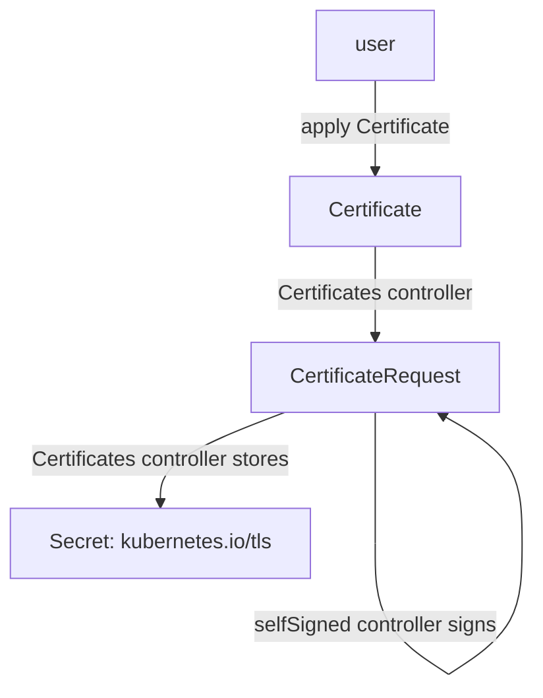

# From Issuer To Secret

An application that serves TLS needs a certificate and a private key in a Secret. Without an operator, a person creates a key, requests a certificate, copies the result into a Secret and sets a reminder for the renewal. cert-manager replaces those steps with two resources. This part creates them and follows the request through the cluster, so you can say which component did each step and where to look when a step fails.

## The request chain

A **Certificate** is the request that users write. It names the DNS names the certificate must cover, the Secret where the result goes and the issuer that signs it. An **Issuer** is a namespaced resource that describes how to sign. A **ClusterIssuer** is the same type without a namespace. A **CertificateRequest** is an internal resource that holds one signing request. The user does not write it. The controllers create it.

The `selfSigned` issuer type signs a certificate with the private key of that same certificate. No certificate authority is involved, so a client must be told to trust the certificate explicitly. This makes it a good first test, and it is also how some operators create the CA certificate for a private CA.

The chain has four steps, and different controllers inside the `cert-manager` Deployment run them. The Certificates controller sees a Certificate with no Secret and starts issuing. It generates a private key and creates a CertificateRequest with a signing request. The selfSigned controller sees the request, signs it and writes the certificate into the request status. The Certificates controller then writes the key and the certificate into the Secret that `spec.secretName` names.



The diagram shows that the Certificate is the input, the Secret is the output, and the CertificateRequest is the step between them.

## Try it: create an Issuer and a Certificate

Save this as `issuer-starfleet-issuer.yaml`:

<!-- astrona:playground:renew -->

```yaml
apiVersion: cert-manager.io/v1
kind: Issuer
metadata:
  name: starfleet-issuer
  namespace: starfleet
spec:
  selfSigned: {}
```

Apply it:

```sh
kubectl apply -f issuer-starfleet-issuer.yaml
```

Then check the result:

```sh
kubectl -n starfleet get issuer starfleet-issuer
```

The `READY` column shows `True`. The Issuer controller checked the issuer and set a `Ready` condition on it. Now request a certificate. Save this as `certificate-probe-cert.yaml`:

```yaml
apiVersion: cert-manager.io/v1
kind: Certificate
metadata:
  name: probe-cert
  namespace: starfleet
spec:
  secretName: probe-tls
  dnsNames:
    - probe.starfleet.svc
    - probe.starfleet.svc.cluster.local
  issuerRef:
    name: starfleet-issuer
    kind: Issuer
    group: cert-manager.io
```

Apply it:

```sh
kubectl apply -f certificate-probe-cert.yaml
```

Then check the result:

```sh
kubectl -n starfleet get certificate,certificaterequest,secret
```

The Certificate is `READY` `True` after a few seconds. One CertificateRequest named like `probe-cert-1` exists and is approved and ready. A Secret `probe-tls` exists with the type `kubernetes.io/tls`. You wrote one resource and cert-manager produced the other two.

## Read the Secret and the status

Describe the Secret to see what it holds, without printing the key:

```sh
kubectl -n starfleet describe secret probe-tls
```

The data section lists `tls.crt` and `tls.key` with their sizes in bytes. The annotations name the issuer and the Certificate that produced the Secret, for example `cert-manager.io/certificate-name: probe-cert`. A pod can mount this Secret as a volume or an Ingress can refer to it by name.

The Certificate status shows the lifetime of the issued certificate:

```sh
kubectl -n starfleet get certificate probe-cert -o jsonpath='{.status.notBefore}{"\n"}{.status.notAfter}{"\n"}{.status.renewalTime}{"\n"}'
```

The command prints three times. The certificate is valid between `notBefore` and `notAfter`. With no `duration` in the spec, cert-manager uses 2160 hours, which is 90 days. `renewalTime` is the moment when cert-manager will start the renewal. With no `renewBefore`, it is one third of the duration before the end. The controller sets a timer for that moment. No pod and no person needs to trigger the renewal.

## Conditions and events

Conditions are the status entries that tell a reader whether the resource works. A Certificate has two. `Ready` is `True` when the Secret holds a valid certificate that matches the spec and is not due for renewal. `Issuing` is `True` while the controllers issue or renew the certificate. Each condition has a `reason` and a `message`. The message is the first place to look in a failure.

Events are short records that a controller writes about what it did. Read the events of the Certificate:

```sh
kubectl -n starfleet describe certificate probe-cert
```

The `Events` section at the end lists what the Certificates controller did. It shows, for example, a reason `Issuing` that says the certificate is issued because the Secret does not exist, a reason `Generated` for the new private key, a reason `Requested` for the new CertificateRequest, and a final `Issuing` event that says the certificate was issued. Events are kept for a short time, by default one hour, and the status conditions stay.

## A failure you can read

Make a Certificate that refers to an Issuer that does not exist. Save this as `certificate-shuttle-cert.yaml`:

```yaml
apiVersion: cert-manager.io/v1
kind: Certificate
metadata:
  name: shuttle-cert
  namespace: starfleet
spec:
  secretName: shuttle-tls
  dnsNames:
    - shuttle.starfleet.svc
  issuerRef:
    name: missing-issuer
    kind: Issuer
    group: cert-manager.io
```

Apply it:

```sh
kubectl apply -f certificate-shuttle-cert.yaml
```

Then check the result:

```sh
kubectl -n starfleet get certificate shuttle-cert
kubectl -n starfleet describe certificate shuttle-cert
```

The Certificate stays `READY` `False`, and no Secret `shuttle-tls` appears. The webhook accepted the Certificate, because its fields are valid. The failure comes later, in the controllers: the status and the events name the issuer that cannot be found. Create an Issuer named `missing-issuer` in `starfleet` and the Certificate becomes ready without another edit, because the controller retries.

This case shows why the status matters more than the exit code of `kubectl apply`. The apply succeeded in both cases. Only the condition tells you whether a certificate exists.

You now know the chain from Certificate to Secret, which controller does each step, and where the status and events record a failure. The open question is what happens to this setup when the operator or its CRDs are upgraded, and what the controller's permissions let it do to the rest of the cluster.

## Common pitfalls

> [!WARNING]
> - A successful `kubectl apply` of a Certificate says only that the webhook and the schema accepted it. Check the `Ready` condition and the Secret.
> - An Issuer is namespaced. A Certificate in `starfleet` cannot use an Issuer in `outpost`. Use a ClusterIssuer when many namespaces share one issuer, and set `kind: ClusterIssuer` in `issuerRef`. The default `kind` is `Issuer`.
> - A selfSigned certificate is not trusted by clients. A browser or an application that validates the certificate chain rejects it unless it is told to trust it.
> - Never copy or edit `tls.key` and `tls.crt` by hand in a Secret that cert-manager manages. The next reconcile finds the difference and issues a new certificate.
> - A `duration` below one hour and a `renewBefore` below five minutes are rejected by the webhook. A `renewBefore` that is longer than the `duration` is invalid too.
